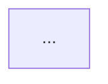

# AGENTS.md — Object Detection LLMwiki 維護指南

本文件是 **物件偵測知識庫（Object Detection LLMwiki）** 的核心運作架構與規範協議（Schema）。
所有維護此知識庫的 AI Agent（包括 Antigravity、Claude Code、Codex 等）都必須嚴格遵守本規範。

---

## 1. 核心哲學與四大準則 (Core Philosophy & Guiding Principles)

> 「Wiki 是一個持續積累的程式碼庫（Codebase），LLM 是負責維護與重構的工程師，人類是總架構師與總編輯。」

### 四大最高執行準則：
1. **初學者友善與演進敘事（Beginner-Friendly Evolution）**：
   - 知識庫的解說必須兼顧專業性與易讀性，讓初學者也能循序漸進理解。
   - **痛點驅動（Pain-point Driven）**：在介紹任何新架構或模組前，必須先說清楚「前一代遇到什麼瓶頸？為什麼需要這項創新？」。
   - 多使用直觀架構圖解（Mermaid Flowchart）、表格比對與生活化類比，避免無上下文的數學術語堆砌。
2. **客觀事實對照，絕不做額外推論（Strict Evidence & Zero Speculation）**：
   - **嚴格事實導向**：所有技術細節、Benchmark 數據與論點，必須來自文獻原文。
   - **矛盾處理原則**：當論文 A 與論文 B 出現互相矛盾的宣稱或數據時（例如檢測速度 vs 精度的權衡、不同評估條件下的 mAP 比較），Agent 必須**建立對比證明表**，如實並列雙方的實驗設定（硬體、解析度、資料集版本）、原作者論點與原文證據，**嚴禁 Agent 自行做未經證實的假設、腦補或主觀推論**。
3. **全程來源追溯（Provenance & Citation）**：
   - 任何關鍵數據（mAP、FPS、延遲、參數量）、公式、架構特點與引述，必須標明精準來源（作者、論文/文章標題、年份、章節或 `raw/` 相對檔案路徑）。
4. **簡報化產出支援（Slide-Ready Output）**：
   - 頁面結構須高度模組化，每個演進章節都提煉出清晰的 Key Takeaways。
   - 支援將 Wiki 內容無縫轉換為簡報格式（如相容於 Marp 的 Markdown 投影片），專門存放於 `wiki/presentations/`。

---

## 2. 目錄架構 (Directory Architecture)

```text
LLMwiki/
├── AGENTS.md                          # 本規範協議文件（核心 Schema）
├── index.md                           # 知識庫總導覽與目錄（語義索引）
├── log.md                             # 變更歷史日誌（時間序列）
│
├── raw/                               # 【原始資料層（Immutable Truth，唯讀）】
│   ├── papers/                        # 論文原文（PDF / Markdown 轉錄）
│   ├── articles/                      # 技術部落格、官方教學文章
│   └── assets/                        # 原始圖片、架構圖、圖表
│
└── wiki/                              # 【知識庫主體層（Persistent Wiki，持續複利）】
    ├── basics/                        # 基本任務定義與架構（Classification vs Detection, Pipeline）
    ├── models/                        # 模型專頁（R-CNN 家族, YOLO 系列, DETR 系列等）
    ├── concepts/                      # 核心模組與技術概念
    │   ├── backbones/                 # 特徵提取網絡（ResNet, CSPDarknet, Swin, ConvNeXt）
    │   ├── necks/                     # 特徵融合層（FPN, PANet, BiFPN）
    │   ├── heads/                     # 預測頭（Anchor-based, Anchor-free, DETR Head）
    │   ├── losses/                    # 損失函數（CIoU, GIoU, Focal Loss, Varifocal Loss）
    │   ├── assignment/                # 正負樣本匹配策略（MaxIoU, ATSS, SimOTA, Task-aligned）
    │   └── postprocessing/            # 後處理（NMS, Soft-NMS, NMS-free, OBB 旋轉處理）
    ├── benchmarks/                    # 評估指標與資料集（mAP, IoU, COCO, VOC, DOTA）
    ├── applications/                  # 進階應用場景（OBB 旋轉框、遙感航拍、傾斜文字等）
    ├── synthesis/                     # 橫向對比、技術演進脈絡與矛盾證明表
    └── presentations/                 # 簡報投影片（Marp Markdown 簡報檔）
```

---

## 3. 頁面規範與 Frontmatter 格式

所有在 `wiki/` 下建立的頁面，頂部必須包含標準 YAML Frontmatter：

```markdown
---
title: "頁面名稱"
type: "model | concept | benchmark | basics | application | synthesis | presentation"
created: "YYYY-MM-DD"
updated: "YYYY-MM-DD"
tags: [ObjectDetection, 相關標籤...]
sources:
  - "[來源名稱](raw/articles/01-ibm-what-is-object-detection.md)"
related:
  - "[相關頁面](wiki/concepts/backbones/overview.md)"
---

# 頁面標題

## 1. 初學者導讀 (Beginner-Friendly Intuition)
> 用最直白的生活化比喻或痛點背景，說明此技術要解決的核心問題。

## 2. 前代瓶頸與演進動機 (Evolution & Motivation)
- 前代架構痛點：...
- 本架構突破點：...

## 3. 核心機制圖解與分析 (Core Mechanism)


## 4. 實驗數據與客觀依據 (Benchmark & Empirical Evidence)
| 指標 | 數值 | 測試條件（硬體/輸入尺寸/資料集） | 資訊來源 |
| :--- | :--- | :--- | :--- |
| mAP  | ...  | ...                              | [論文作者, 年份, 表X] |

## 5. 爭議、限制與矛盾對比 (Contradictions & Trade-offs)
*若無爭議則標明局限性；若存在文獻間之矛盾宣稱，需建立客觀對照表，不作主觀腦補。*
```

---

## 4. 四大標準作業程序 (SOP)

### SOP 1: Ingest（錄入新文獻 / 新來源）
當使用者提供新來源時，Agent 執行：
1. **閱讀與解析**：深度閱讀 `raw/` 來源文件，提取出：
   - 解決的核心痛點、背景演進脈絡。
   - 核心創新模組（Backbone、Neck、Head、Loss、Assignment、Postprocessing）。
   - 實驗成果數據（明確標記硬體環境與條件）。
   - 侷限性或與其他文獻的潛在矛盾點。
2. **與使用者對齊關鍵點**：簡要列出 3~5 點初心友善的 Key Takeaways，向使用者確認重點。
3. **建立主實體頁面**：在對應的 `wiki/` 目錄下建立頁面，內嵌 Mermaid 流程圖與來源標記。
4. **漣漪更新（Ripple Updates）**：
   - 跨頁更新 3~5 個相關概念頁與綜合頁。
   - 若發現與現有 Wiki 頁面存在矛盾或數據差異，在相關頁面的「爭議與矛盾對比」區塊加入客觀比對。
5. **更新索引與日誌**：
   - 在 `index.md` 與 `log.md` 追加紀錄。

---

### SOP 2: Query（查詢、推理與知識回存）
1. **檢索導覽**：優先查閱 `index.md` 與相關 `wiki/` 頁面。
2. **結構化回答**：先給初學者能懂的直觀結論，再給深度技術細節與對比表格，所有陳述均標記來源。
3. **回存機制**：有價值的問答梳理自動存入 `wiki/synthesis/`。

---

### SOP 3: Lint（知識庫健康檢查）
定期或使用者觸發：
1. **檢查孤島頁面與死鏈**。
2. **檢查矛盾陳述未對齊**：是否最新錄入的文獻推翻了舊文獻的結論，但尚未標註各自實驗條件差異。
3. **檢查來源標記遺漏**：是否有未標明來源出處的數據。

---

### SOP 4: Graph Construction（知識圖譜規劃與製作）
當使用者要求建立或更新 Graph 時，Agent 執行：
1. **需求與範圍確認**：定義 Graph 用途、主題範圍、受眾與閱讀方向。
2. **資料盤點**：先讀取 `index.md` 與相關 Wiki 頁面，再回查 `raw/`；不可只憑模型常識補邊。
3. **Graph 規劃**：先列出圖形類型、節點類型、關係詞彙、群組與閱讀方向。
4. **結構化建構**：先更新 `graph/<topic>-graph.json`，每個節點與關係均需有唯一 ID / 明確語意 / 來源路徑。
5. **大綱確認**：檢查主線、分支、節點密度、孤立節點、重複節點與無證據關係；必要時先修正結構。
6. **視覺化輸出**：由 JSON 整理 Mermaid 或其他視覺化格式；圖上標籤使用繁體中文並保留必要英文術語。
7. **簡報整合**：先依 Graph 主線安排簡報順序，再補充分支、數據、限制與來源。
8. **初版檢查與回修**：檢查箭頭方向、關係標籤、文字可讀性、版面交叉線與來源；修改 JSON 後重新輸出。
9. **同步更新**：更新 `index.md`、`log.md`，並檢查 Graph 節點指向的 Wiki 路徑。

**Graph 視覺原則**：可依主題使用分群與色彩區分節點類型；預設採左至右或上至下單一閱讀方向，箭頭使用清楚的動詞關係。避免只靠顏色傳達語意。

---

### SOP 5: Presentation Generation（產生教學簡報）
當使用者要求產出簡報時：
1. **主題與受眾定位**：以「初學者容易理解的演進史」為主軸，強調「痛點 -> 突破 -> 權衡」。
2. **格式規範**：使用標準 Marp Markdown 格式（支援投影片分頁 `---`、雙欄對比、重點條列與圖解）。
3. **存檔路徑**：儲存至 `wiki/presentations/<主題名稱>.md`。
4. **客觀與可追溯**：每張投影片底部均標明 `來源：[作者, 年份, 文獻名]`。
5. **Graph 驅動敘事**：先參照 `graph/` 的節點與關係確認主線，避免簡報只羅列名詞；Graph 僅作結構導航，具體敘述仍回到 Wiki / raw 證據。

---

## 5. 核心文獻收錄對應表

| 順序 | 主題 / 任務 | 來源資料 | 初學者核心觀念 | 預計落地的 Wiki 模組 |
| :--- | :--- | :--- | :--- | :--- |
| **01** | 基本任務定義與架構 | IBM Think: *What is Object Detection?* | 分類 vs 畫框 vs 偵測；像素網格與通用檢測管線 | `wiki/basics/` |
| **02** | Two-stage 演進史 | Lil'Log: *R-CNN Family* (Lilian Weng) | 從 2000 個候選框到神經網路自己提候選框（痛點驅動演進） | `wiki/models/`、`wiki/concepts/assignment/rpn.md`、`wiki/concepts/postprocessing/nms.md` |
| **03** | One-stage 核心突破 | CVPR 2016: *YOLOv1 (arXiv:1506.02640)* | 只看一眼的迴歸思想；速度與小物件定位的取捨矛盾 | `wiki/models/yolov1.md`、`wiki/synthesis/two-stage-vs-one-stage.md` |
| **04** | 核心評估指標 | Roboflow: *What is Mean Average Precision (mAP)?* | 怎麼客觀評價「框得準不準」？IoU 門檻與 P-R 曲線解密 | `wiki/benchmarks/iou.md`、`wiki/benchmarks/map.md` |
| **05** | 進階應用：旋轉框 | Ultralytics: *Oriented Bounding Box (OBB)* | 為什麼斜著的物體傳統框不住？衛星航拍與角度週期挑戰 | `wiki/applications/obb.md`、`wiki/concepts/postprocessing/rotated-nms.md` |
