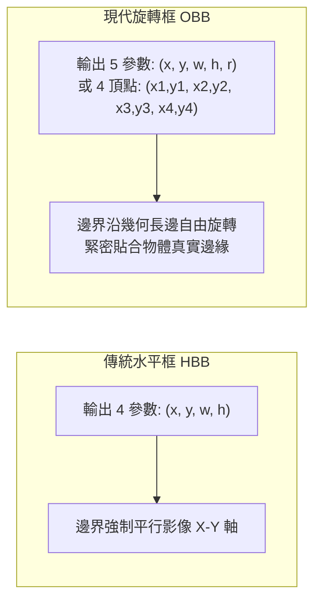

# 旋轉邊界框 (Oriented Bounding Box, OBB) 物件偵測原理與應用

## 1. 初學者導讀 (Beginner-Friendly Intuition)
> **停車場斜插車位與港口船隻比喻**：
> - **傳統水平框（HBB）**：就像一個只能拿四方正正紙箱的粗暴快遞員。如果停車場上的車輛全都是斜著 45 度角停放，快遞員只能拿一個超級巨大的正方形大箱子把整輛車裝進去。結果箱子裡 70% 都是柏油路；更慘的是，隔壁那輛車的大箱子會跟這輛車的大箱子嚴重撞在一起，害得系統以為兩輛車是同一台，直接丟掉其中一台！
> - **旋轉框（OBB）**：快遞員學會了「轉動箱子」。箱子順著車身的 45 度角旋轉貼合。沒有任何多餘的柏油路背景，旁邊即使並排停了 10 輛車，箱子之間也互不干擾、清清楚楚！

---

## 2. 前代瓶頸與演進動機 (Evolution & Motivation)
在第 1 篇 [基礎任務定義](../basics/task-definition.md) 中，我們曾提到標準水平框（Horizontal Bounding Box, HBB）的先天局限。在特定工業與空照場景中，這些局限演變為致命瓶頸：

- **痛點 1：包覆海量背景雜訊（Background Clutter）**  
  在無人機或衛星空照圖中，細長物體（如軍艦、貨輪、飛機、跑道）通常具有特定朝向。水平框會將周遭大量海水、停機坪包進框內，破壞特徵提取的信噪比。
- **痛點 2：密集排列下 NMS 的「誤刪悲劇」**  
  當多艘長條形船隻以 45 度角平行並排靠泊時，相鄰兩艘船的水平外接矩形會產生極大的交疊（水平 IoU 常 $> 0.7$）。標準 NMS 會將旁邊真實的目標當作重複預測而**直接刪除**，導致漏檢。
- **演進突破點**：  
  在傳統 $(x, y, w, h)$ 的基礎上引入旋轉角度參數 $r$，讓邊界框具備朝向自主性 [Ultralytics, 2024]。

---

## 3. 核心機制與座標格式定義 (Core Mechanisms)

### 3.1 兩種主流資料格式
1. **五參數旋轉格式 (`xywhr`)**：
   - 中心點座標 $(x, y)$、寬度 $w$、高度 $h$ 以及旋轉角度 $r$（通常以弧度 Radian 表示）。
2. **四頂點多邊形格式 (`xyxyxyxy`)**：
   - 記錄矩形四個頂點的有序幾何座標 $[x_1, y_1, x_2, y_2, x_3, y_3, x_4, y_4]$，常用於 DOTA 航空遙感資料集標註。

### 3.2 角度週期對稱性與邊界跳躍問題 (Angle Periodicity & Boundary Jump)
OBB 模型訓練中最棘手的數學難題是**角度邊界不連續性**：
- **$180^\circ$ 幾何週期性**：一個矩形旋轉 $180^\circ$（$\pi$ 弧度）後，在視覺幾何上完全等同於原來的矩形。
- **邊界跳躍（Boundary Jump）**：若角度定義域設為 $[-\pi/2, \pi/2)$，當物體旋轉穿過邊界（如從 $-89^\circ$ 微小轉動到 $+89^\circ$），角度數值跳變高達 $178^\circ$。神經網路如果直接計算數值差損失，會引發巨大的梯度震盪。
- **Ultralytics 解決方案**：採用長邊基準定義（Long-edge convention），將角度正規化在 $[-\pi/4, 3\pi/4)$ 區間，配合週期性平滑旋轉損失函數 [Ultralytics, 2024]。

---

## 4. 實驗數據與客觀依據 (Empirical Evidence)

以下數據摘錄自 Ultralytics 官方在國際權威航拍遙感資料集 **DOTA v1.0** 上的測試結果：

| 模型名稱 | 輸入尺寸 (pixels) | DOTA v1.0 $\text{mAP}_{50}$ | 參數量 (Params) | 計算量 (FLOPs) | 資訊來源 |
| :--- | :--- | :--- | :--- | :--- | :--- |
| **`yolov8n-obb`** (Nano 輕量級) | 1024 | **78.0%** | 3.1 M | 23.3 B | [Ultralytics, 2024] |
| **`yolov8s-obb`** (Small 平衡級) | 1024 | 79.5% | 11.4 M | 76.3 B | [Ultralytics, 2024] |
| **`yolov8m-obb`** (Medium 性能級) | 1024 | 80.5% | 26.4 M | 168.6 B | [Ultralytics, 2024] |

---

## 5. 限制與技術代價 (Trade-offs & Constraints)
1. **計算複雜度增加**：旋轉框之間的重疊面積不能使用簡單的 $\min/\max$ 座標計算，必須依賴多邊形求交演算法（Sutherland-Hodgman Polygon Clipping），推論後處理耗時略高於標準 HBB。
2. **標註成本高昂**：標註旋轉框需要精準點擊 4 個頂點或調整旋轉滾輪，標註耗時通常是傳統水平框的 3 到 5 倍。

---

## 6. 簡報重點提煉 (Slide-Ready Key Takeaways)
- **核心價值**：徹底解決遙感航拍與傾斜文字場景中「背景雜訊過多」與「密集排列 NMS 誤刪」兩大絕症。
- **表示維度**：從 4 參數 $(x, y, w, h)$ 升級為 5 參數 $(x, y, w, h, r)$ 或 8 參數四頂點。
- **數學挑戰**：矩形具備 $180^\circ$ 旋轉對稱性，需透過特定定義域（如 $[-\pi/4, 3\pi/4)$）壓制邊界跳躍。
