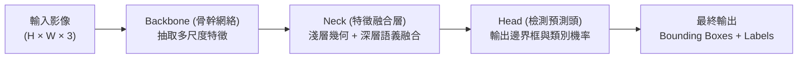
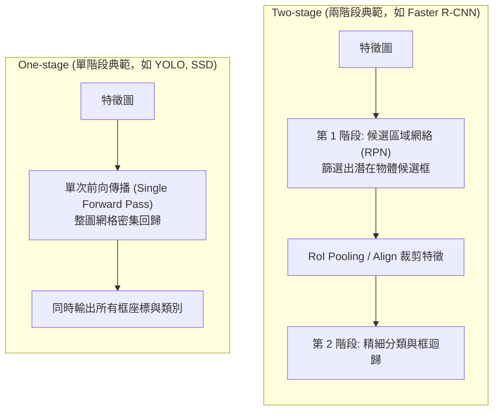

# 現代物件偵測通用架構：從像素網格到 Backbone、Neck 與 Head

## 1. 初學者導讀 (Beginner-Friendly Intuition)
> **工廠流水線比喻**：想像一個專門檢驗照片並標記物體的自動化工廠：
> 1. **原料入場（像素網格）**：相機送進來的是一大批由紅綠藍數字組成的點陣圖（像素矩陣），電腦本身並不知道哪裡有貓。
> 2. **資深初審員（Backbone / 骨幹網絡）**：專門負責「抽絲剝繭」。它一層層掃描照片，從最細微的線條、斑點，一路歸納出輪廓、器官、材質等抽象特徵。
> 3. **特徵調度部（Neck / 特徵融合頸部）**：負責「融會貫通」。大物體需要看大範圍上下文，小物體需要看清晰的細部紋理。Neck 將深層的「語義知識」和淺層的「幾何細節」攪拌均勻。
> 4. **蓋章裁決員（Head / 檢測頭）**：負責「最終拍板」。看著調度好的特徵，一手畫出方框 $(x, y, w, h)$，一手蓋上標籤戳章（例如「汽車 95%」）。

---

## 2. 數位影像的本質：取樣與量化 (Digital Image Representation)
根據 [IBM Think, 2024]，電腦並不像人類大腦一樣「看見」物體的概念，而是處理數值矩陣：

1. **取樣（Sampling）**：將自然界連續的空間光影，離散化切割成由二維格子構成的像素網格（Grid of Pixels，寬 $W \times$ 高 $H$）。
2. **量化（Quantization）**：將連續的光強度數值，轉換為離散的數值階層（最常見為 8-bit，即 0 到 255 的整數）。
3. **色彩通道（Color Channels）**：一張標準彩色影像通常由紅（R）、綠（G）、藍（B）三個通道疊加而成，在記憶體中呈現為一個三維張量（Tensor），尺寸為 $H \times W \times C$。

---

## 3. 現代偵測器的通用三大核心模組 (Universal Pipeline)

現代深度學習物件偵測架構幾乎都可以抽象拆解為三大區塊：

### 三大模組功能與職責比對
| 模組名稱 | 英文名稱 | 主要承擔任務 | 代表性架構技術 | 來源出處 |
| :--- | :--- | :--- | :--- | :--- |
| **骨幹網絡** | **Backbone** | 特徵提取器。將高解析度的原始像素壓縮轉化為多尺度的特徵圖（Feature Maps）。 | ResNet, CSPDarknet, Swin Transformer | [IBM Think, 2024] |
| **特徵融合層** | **Neck** | 特徵聚合器。連接 Backbone 與 Head，解決「不同大小物體（尺度差異 Scale Variance）」的偵測瓶頸。 | FPN (Feature Pyramid Network), PANet, BiFPN | [IBM Think, 2024] |
| **檢測頭** | **Head** | 預測器。基於融合後的特徵圖，輸出物體類別機率與邊界框座標。 | Anchor-based Head, Anchor-free Head, DETR Head | [IBM Think, 2024] |

---

## 4. 兩大架構典範的分歧點 (Two-stage vs. One-stage)

在檢測管線的設計上，深度學習歷史分化為兩大主流路線（詳見 [Two-stage 與 One-stage 橫向對比](../synthesis/two-stage-vs-one-stage.md)）：

- **兩階段（Two-stage）**：先提候選區域（Where），再精細分類（What）。優點是精度高，缺點是步驟多、推論延遲較高。
- **單階段（One-stage）**：將問題視為單一迴歸，一步到位同時預測 Where 與 What。優點是極度高效且適合即時應用，但對小目標或密集目標要求更強的特徵融合設計。

---

## 5. 簡報重點提煉 (Slide-Ready Key Takeaways)
- **通用三層架構**：所有現代物件偵測模型均可解構為 **Backbone（特徵提取）→ Neck（特徵融合）→ Head（預測輸出）**。
- **特徵的層次性**：淺層特徵富含幾何邊緣與位置細節，深層特徵富含抽象語義；Neck 的出現正是為了打破兩者的隔閡。
- **兩大典範**：Two-stage 追求「慢而精細」，One-stage 追求「快而即時」。
