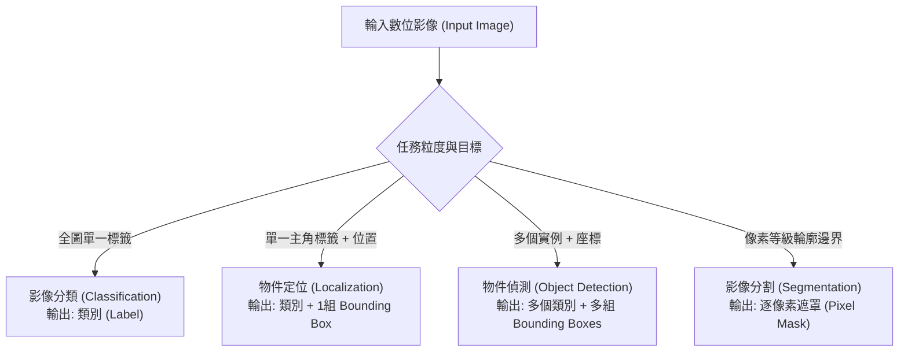

# 電腦視覺基礎任務定義：影像分類、物件定位與物件偵測

## 1. 初學者導讀 (Beginner-Friendly Intuition)
> **生活化比喻**：想像你收到一張朋友在夜市的合照。
> - **影像分類（Classification）**：你只瞄了一眼說：「這張照片有夜市小吃。」（只管全圖整體是什麼，不管具體有幾樣、在哪裡）。
> - **物件定位（Localization）**：你伸出手指指著正中央最大碗的牛肉麵說：「牛肉麵在正中間這個框框裡。」（只找單一主角並圈出位置）。
> - **物件偵測（Object Detection）**：你拿出一支紅筆，把照片裡的「牛肉麵、珍奶、三位朋友、兩輛機車」全部各自畫上框框，並標明每一碗是吃的、每個人是誰。（同時解決**「是什麼（What）」**與**「在哪裡（Where）」**，且能應對**多個物體**）。

---

## 2. 前代瓶頸與演進動機 (Evolution & Motivation)
在電腦視覺發展初期，影像分類（如 ImageNet 競賽）取得了巨大成功。然而在真實世界中，影像分類面臨著嚴重的實務痛點：

- **痛點 1：無法處理多物體共存**  
  現實影像中幾乎不會只有單一物體。若一張自動駕駛照片同時有行人、紅綠燈與車輛，分類模型只能給出單一最高機率標籤（例如「道路」），完全無法得知畫面上存在隨時可能過馬路的行人。
- **痛點 2：缺乏空間幾何座標**  
  機器手臂需要抓取零件、無人機需要避障、自動駕駛需要精確煞停，系統必須知道物體在畫面的「具體座標位置」，單純的類別標籤無法提供幾何資訊。
- **演進突破點**：  
  物件偵測將「分類（語義理解）」與「迴歸（空間座標預測）」融合為一體，正式讓電腦視覺具備了空間感知能力。

---

## 3. 四大核心任務直觀對比 (Core Tasks Comparison)

### 客觀技術特點對照表
| 任務名稱 | 核心輸出 | 輸入限制 / 特點 | 空間精確度 | 典型應用場景 | 來源出處 |
| :--- | :--- | :--- | :--- | :--- | :--- |
| **影像分類** (Image Classification) | 單一類別機率（如 "Dog: 98%"） | 預設全圖以單一主體為主 | 無空間座標 | 醫療相片粗篩、相簿智慧分類 | [IBM Think, 2024] |
| **物件定位** (Object Localization) | 單一類別 + 1 個邊界框 $(x, y, w, h)$ | 通常針對畫面中唯一突出的主角 | 矩形粗框（單一物體） | 單品瑕疵檢測、臉部辨識對焦 | [IBM Think, 2024] |
| **物件偵測** (Object Detection) | 多個類別 + 多個邊界框清單 | 同時支援多類別、多目標實例共存 | 矩形粗框（多目標） | 自動駕駛、安防監控、機器人導航 | [IBM Think, 2024] |
| **影像分割** (Image Segmentation) | 每個像素所屬的類別標籤（遮罩 Mask） | 計算成本最高，區分語義分割與實例分割 | 逐像素輪廓邊界 | 醫療腫瘤輪廓提取、精密去背 | [IBM Think, 2024] |

---

## 4. 物件偵測的核心雙重任務：What + Where

物件偵測之所以具備挑戰性，是因為它必須同時解開兩個數學性質完全不同的問題：

1. **定性問題（分類 Classification / What）**：
   - 數學形式：離散機率分佈預測（如 Softmax 或 Sigmoid）。
   - 評估方式：交叉熵損失（Cross-Entropy Loss）。
2. **定量問題（定位 Localization / Where）**：
   - 數學形式：連續數值座標迴歸（Regression）。
   - 表示方法：邊界框（Bounding Box），常以中心點與寬高 $(x, y, w, h)$ 或左上右下頂點 $(x_1, y_1, x_2, y_2)$ 表示。
   - 評估方式：Smooth L1 Loss、IoU 系列損失函數。

---

## 5. 限制與未來演進伏筆 (Limitations & Future Evolution)
根據 [IBM Think, 2024]，傳統物件偵測普遍採用**標準水平邊界框（Horizontal Bounding Box, HBB）**，這在多數日常場景運作良好，但在以下情境存在天然限制：
1. **背景雜訊干擾**：當物體呈斜向（如航拍照片中的船隻、傾斜排列的文字）時，水平矩形框會包覆大量無關背景。
2. **密集重疊誤刪**：當多個物體緊密排列時，水平框高度重疊，容易被後處理（如 NMS）誤認為重複預測而刪除。
   *(這項瓶頸在後續的 [旋轉框 OBB 專題](../applications/obb.md) 將被突破)*。

---

## 6. 簡報重點提煉 (Slide-Ready Key Takeaways)
- **核心定義**：物件偵測 = 「物體分類（是什麼）」+「空間定位（在哪裡）」，且支援「多物體多類別」。
- **演進必然性**：真實世界場景充滿雜訊與多物體，純影像分類無法提供空間座標，物件偵測是空間感知的基石。
- **輸出形式**：類別標籤（Class Label）+ 信心度（Confidence Score）+ 邊界框（Bounding Box Coordinates）。
