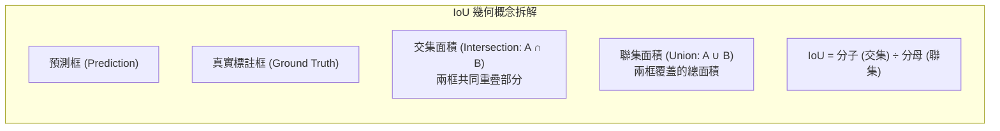

# 交併比 (Intersection over Union, IoU) 計算原理與評估機制

## 1. 初學者導讀 (Beginner-Friendly Intuition)
> **兩張透明貼紙的比喻**：
> 想像桌上有一張代表正確答案的藍色方框貼紙（Ground Truth），模型貼上了一張它預測的紅色方框貼紙（Prediction）：
> - **分子（交集 Intersection）**：兩張貼紙真正重疊、變成紫色的區域（精準命中的部分）。
> - **分母（聯集 Union）**：兩張貼紙覆蓋的全部總面積。
> **IoU 就是「紫色重疊面積 $\div$ 全部覆蓋面積」**：
> - 若兩張貼紙完全吻合，$\text{IoU} = 1.0$（滿分 100%）。
> - 若兩張貼紙稍微碰在一起，$\text{IoU} = 0.2$。
> - 若兩張貼紙完全各走各的，$\text{IoU} = 0.0$。

---

## 2. 幾何定義與數學公式 (Mathematical Definition)

$$\text{IoU}(A, B) = \frac{\text{Area}(A \cap B)}{\text{Area}(A \cup B)} = \frac{\text{Area}(A \cap B)}{\text{Area}(A) + \text{Area}(B) - \text{Area}(A \cap B)}$$

---

## 3. IoU 在現代檢測管線的三大關鍵職責

IoU 不僅僅是一個評估數字，它貫穿了物件偵測模型從訓練到評估的每一個環節：

| 管線環節 | 具體職責 | 門檻設定規範 | 相關頁面 |
| :--- | :--- | :--- | :--- |
| **1. 訓練期：正負樣本分配** | 判斷預設的 Anchor 或網格該學習哪一個真實物體 | $\text{IoU} \ge 0.7$ 為正樣本；$\text{IoU} < 0.3$ 為背景負樣本 | [RPN 機制](../concepts/assignment/rpn.md) |
| **2. 推論期：後處理去重** | 篩除同一個物體周圍成百上千個重複預測框 | 若與最高分框的 $\text{IoU} \ge 0.5$，判定為重複並強制剔除 | [NMS 演算法](../concepts/postprocessing/nms.md) |
| **3. 評估期：判定命中標準** | 判定某個預測框究竟是算「答對 (TP)」還是「答錯 (FP)」 | 寬鬆門檻 $\text{IoU} \ge 0.50$；嚴格門檻 $\text{IoU} \ge 0.75 \sim 0.95$ | [mAP 詳解](map.md) |

---

## 4. 評估時的殘酷規則：重複檢測的懲罰 (Duplicate Detection Penalty)
根據 [Roboflow, 2023] 與 COCO 官方評估標準，如果一個真實物體周圍出現了 3 個預測框，且這 3 個框與真值的 $\text{IoU}$ 通通都超過 0.8：
- **只有置信度最高的那 1 個框**被核准為 **True Positive (TP)**。
- **其餘 2 個預測框一律嚴格計為 False Positive (FP)**！
> **初學者避坑重點**：這項規則迫使檢測模型必須仰賴 NMS 或端到端集合預測來過濾多餘框，否則預測框越多，FP 越多，Precision 就會直線暴跌！

---

## 5. 幾何擴展：從水平 IoU 到旋轉框 Rotated IoU
在航空遙感或傾斜目標場景中，標準軸對齊 IoU 會失效。此時需計算兩個旋轉矩形的凸多邊形相交面積，即 **Rotated IoU**（詳見 [旋轉非極大值抑制 Rotated NMS](../concepts/postprocessing/rotated-nms.md) 與 [旋轉邊界框 OBB 專題](../applications/obb.md)）。

---

## 6. 簡報重點提煉 (Slide-Ready Key Takeaways)
- **核心本質**：衡量預測框與真值框的重疊程度，數值介於 $0.0 \sim 1.0$。
- **三大應用**：正負樣本分配（訓練）、NMS 去重（推論）、TP/FP 判定（評估）。
- **重複懲罰**：一個真實目標只能配對一個 TP，其餘重複預測全部嚴懲為 FP。
