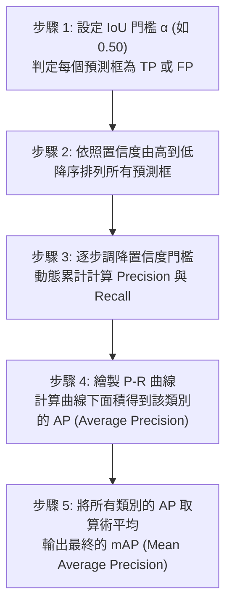

# 平均精度均值 (Mean Average Precision, mAP) 計算指南與 COCO 評估標準

## 1. 初學者導讀 (Beginner-Friendly Intuition)
> **射箭比賽的計分法比喻**：
> - **Precision（箭無虛發）**：你射出了 10 支箭，有幾支真正命中紅心？（衡量模型有沒有亂開槍、亂報假警報）。
> - **Recall（沒有遺漏）**：樹林裡原本有 10 隻野鹿，你成功射中了幾隻？（衡量模型有沒有漏掉目標）。
> - **置信度調度（Confidence Threshold）**：如果你只在極度有把握時才射箭，命中率（Precision）極高，但你會錯過許多猶豫的機會（Recall 低）；如果你瘋狂亂射，獵物大多打中了（Recall 高），但滿地都是射偏的廢箭（Precision 暴跌）。
> - **AP（綜合射箭實力）**：把你在各種「保守到激進」狀態下的成績畫成一條曲線，計算曲線下的總面積！
> - **mAP（十項全能平均分）**：射鹿、射鳥、射靶所有項目的 AP 加總平均！

---

## 2. mAP 的五步計算全流程 (Step-by-Step Calculation)

### 關鍵公式一覽
1. **Precision (精確率)**：$\text{Precision} = \frac{\text{TP}}{\text{TP} + \text{FP}}$ （所有預測中有多少是真的）
2. **Recall (召回率)**：$\text{Recall} = \frac{\text{TP}}{\text{TP} + \text{FN}}$ （所有真實目標中找到了多少）
3. **mAP (跨類別平均)**：$\text{mAP} = \frac{1}{N} \sum_{i=1}^{N} \text{AP}_i$ （$N$ 為總類別數）

---

## 3. 核心指標對照：mAP@50 vs. mAP@50:95 (COCO 標準)

在閱讀物件偵測論文時，讀者最容易困惑的是：為什麼同一篇論文裡會有 `mAP@0.5` 和 `mAP@0.5:0.95` 兩個差距巨大的數字？

### 客觀標準對比表
| 評估指標名稱 | 採用的 IoU 門檻 $\alpha$ | 嚴格程度 | 主要考核目標 | 代表性歷史資料集 | 資訊來源 |
| :--- | :--- | :--- | :--- | :--- | :--- |
| **mAP@50** (或 $\text{AP}_{50}$) | 單一固定門檻 $\text{IoU} = 0.50$ | 較寬鬆 | 考核模型「**有沒有找到物體**」（粗略定位即及格） | PASCAL VOC (2007~2012)、早期 YOLO 論文 | [Roboflow, 2023] |
| **mAP@75** (或 $\text{AP}_{75}$) | 單一固定門檻 $\text{IoU} = 0.75$ | 嚴格 | 考核模型對邊界框位置的貼合度 | COCO 二級指標 | [Roboflow, 2023] |
| **mAP@50:95** (COCO Primary AP) | 遍歷 10 個門檻： $0.50, 0.55, 0.60, ..., 0.95$ （步長 0.05）取平均 | **極度嚴格** | 同時考核「**有沒有找到**」與「**邊界框邊緣框得有多緊密**」 | **現代 COCO Benchmark 黃金標準** | [Roboflow, 2023; Lin et al., 2014] |

### 為什麼模型在 mAP@50 和 mAP@50:95 表現會有巨大落差？
- **真實案例分析**：
  - 一個邊界框畫得鬆垮、略為偏移的模型（例如中心點偏了、寬高偏大 20%）：
  - 在 $\text{IoU} = 0.50$ 時，它能輕易拿到及格（TP），因此它的 **mAP@50 可能高達 70%**；
  - 但當評估門檻提升到 $\text{IoU} = 0.75, 0.85, 0.90$ 時，這個鬆垮的框因為重疊度不足，全數被判定為 **FP**！
  - 最終該模型在 **mAP@50:95 可能只有 35%~40%**。
- **結論**：mAP@50:95 逼使現代偵測器不能只做粗暴預測，必須引入高精度的特徵融合（FPN）、精準採樣（RoIAlign）與更平滑的幾何損失（CIoU/GIoU）。

---

## 4. COCO 尺度細分評估指標 (Multi-scale Metrics)
COCO 評估套件特別依據像素面積將物體劃分為三種尺度，診斷模型偏科現象：
- **$\text{AP}_S$ (Small)**：面積 $< 32 \times 32$ 像素的小目標。通常是檢測器得分最低的一項（特徵容易在下採樣中流失）。
- **$\text{AP}_M$ (Medium)**：面積介於 $32^2 \sim 96^2$ 像素之間的中等目標。
- **$\text{AP}_L$ (Large)**：面積 $\ge 96 \times 96$ 像素的大目標。

---

## 5. 簡報重點提煉 (Slide-Ready Key Takeaways)
- **mAP 本質**：P-R 曲線下的面積（AP）在所有類別上的總平均。
- **標準演進**：從早期的 PASCAL VOC（寬鬆的 mAP@50）邁向現代 COCO（遍歷 10 個 IoU 門檻的 mAP@50:95）。
- **雙重考驗**：mAP@50:95 同時考驗「分類正確性」與「邊界框貼合極限」。
