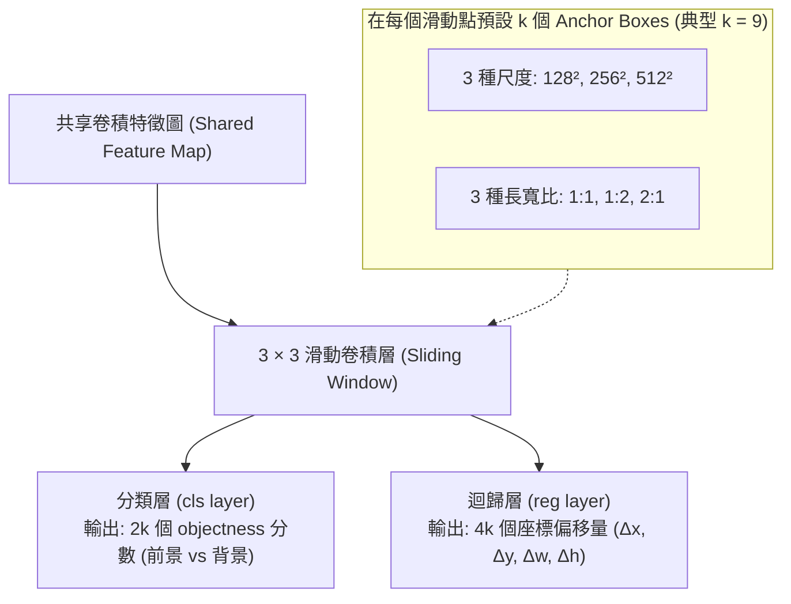

# 區域候選網絡 (RPN) 與錨框 (Anchor Boxes) 機制

## 1. 初學者導讀 (Beginner-Friendly Intuition)
> **看房仲介的比喻**：
> 傳統做法（Selective Search）就像一位老仲介徒步走遍整座城市，用雙眼手動丈量每塊空地，耗時好幾個小時。
> **RPN 與 Anchor Boxes** 就像是一組空拍無人機配合預設規格表：
> - **Anchor Boxes（預設九種房型）**：無人機在城市每個定點上空，直接套用「小套房、中型公寓、大豪宅」等 9 種常見長寬比例模板。
> - **RPN（快速判定儀）**：無人機瞬間掃描並回報：「這裡有 90% 機率是房子，尺寸稍微往右偏一點點。」數毫秒內就完成數千個潛在房屋的初選！

---

## 2. 前代瓶頸與演進動機 (Evolution & Motivation)
- **痛點**：Fast R-CNN 已經將檢測網路優化到 0.32 秒，但前端依賴 CPU 運行的傳統演算法 **Selective Search 仍需 2~2.3 秒**。這意味著檢測流程有接近 90% 的時間浪費在傳統演算法上，且非神經網絡演算法無法進行端到端梯度更新。
- **突破點**：Faster R-CNN 提出 RPN，讓「候選區域提取」完全融入卷積神經網絡中，耗時僅需 **10 ms** [Ren et al., 2015]。

---

## 3. RPN 運作原理與網路架構 (RPN Architecture)

---

## 4. 正負樣本匹配規則 (Label Assignment Rules)
神經網路訓練時，必須決定哪些預設 Anchor 是「正樣本（需要學習靠近物體）」、哪些是「負樣本（純背景）」：

| 樣本類別 | 判定條件 (IoU 門檻) | 訓練行為 | 資訊來源 |
| :--- | :--- | :--- | :--- |
| **正樣本 (Positive / Foreground)** | 1. 與某個真實標註框（Ground Truth, GT）具有**最高 IoU** 的 Anchor；或 2. 與任意 GT 的 **$\text{IoU} \ge 0.7$** 的 Anchor | 同時計算分類損失（Object）與邊界框迴歸損失 | [Ren et al., 2015; Lilian Weng, 2017] |
| **負樣本 (Negative / Background)** | 與所有 GT 框的 **$\text{IoU} < 0.3$** 的 Anchor | 僅計算分類損失（Background），不計算迴歸損失 | [Ren et al., 2015; Lilian Weng, 2017] |
| **忽略樣本 (Ignored)** | $0.3 \le \text{IoU} < 0.7$ 的 Anchor | 不參與該次訓練梯度的反向傳播 | [Ren et al., 2015; Lilian Weng, 2017] |

---

## 5. 邊界框參數化迴歸公式 (Bounding Box Parameterization)
RPN 不直接預測絕對座標，而是預測相對 Anchor 的偏移量與縮放尺度：
$$t_x = (x - x_a) / w_a, \quad t_y = (y - y_a) / h_a$$
$$t_w = \log(w / w_a), \quad t_h = \log(h / h_a)$$
其中 $(x, y, w, h)$ 為預測框，$(x_a, y_a, w_a, h_a)$ 為 Anchor 框。這種對數縮放與標準化設計保證了梯度訓練的數值穩定性 [Girshick et al., 2014; Ren et al., 2015]。

---

## 6. 簡報重點提煉 (Slide-Ready Key Takeaways)
- **RPN 的核心價值**：消除了 CPU 候選框提取瓶頸，實現完全神經網絡端到端檢測。
- **Anchor 理念**：以固定先驗模板框引導網路學習相對偏移，大幅降低迴歸難度。
- **極致速度**：候選框提取時間從 2.3 秒縮減至 10 毫秒（加速 200 倍以上）。
