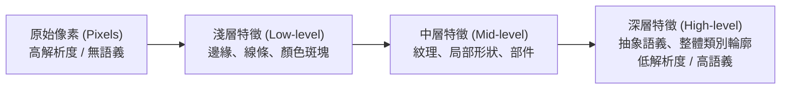

# 特徵提取骨幹網絡總覽 (Backbones Overview)

## 1. 初學者導讀 (Beginner-Friendly Intuition)
> **大腦的視覺皮層比喻**：Backbone 就像人類大腦初級到高級的視覺神經中樞。當光線進入視網膜，首先激活的是辨認「水平與垂直線條」的神經元，接著組合出「圓形與方形」，最後激活能辨認「人臉與輪廓」的區域。Backbone 的工作就是將百萬個獨立的 RGB 像素數值，抽提為具備豐富幾何與語義含義的高階特徵圖。

---

## 2. 前代瓶頸與演進動機 (Evolution & Motivation)
- **傳統方法痛點**：在深度學習崛起前，物件偵測依賴手工設計特徵（Hand-crafted Features，如 SIFT, HOG, Haar Cascades）。這些特徵對光影變化、角度旋轉和物體變形極為脆弱，泛化能力差。
- **深度學習突破點**：卷積神經網絡（CNN）透過大量標註資料自動學習多層次特徵，Backbone 成為整個物件偵測管線的感知基石 [IBM Think, 2024]。

---

## 3. 特徵提取的層次結構 (Hierarchical Features)

---

## 4. 歷史經典骨幹網絡發展脈絡
| 骨幹網絡名稱 | 核心創新機制 | 典型應用代表 | 演進特點 |
| :--- | :--- | :--- | :--- |
| **VGG** | 堆疊 $3 \times 3$ 小型卷積核 | R-CNN, Fast R-CNN, SSD | 結構規整，但參數量極大、計算慢 |
| **ResNet** | 殘差連接（Residual Connections / Skip Connections） | Faster R-CNN, RetinaNet | 解決梯度消失問題，使網絡深度突破 100 層 |
| **Darknet 系列** | 針對即時推論優化的輕量化卷積（Darknet-19, CSPDarknet） | YOLO 系列 | 極度兼顧推論速度與特徵表達能力 |
| **Vision Transformer (ViT)** | 全域自注意力機制（Self-Attention） | DETR, DINO-DETR | 捕捉長距離全域關聯，但小尺度細節需額外設計 |

---

## 5. 簡報重點提煉 (Slide-Ready Key Takeaways)
- **Backbone 的職責**：將連續的數位影像像素矩陣轉化為多尺度特徵圖（Feature Maps）。
- **特徵金字塔天然矛盾**：淺層特徵圖幾何空間解析度高但語義弱；深層特徵圖語義強但空間解析度低（遺失小物件細節）。
- **後續模組銜接**：為了調和深淺層特徵的矛盾，Backbone 抽取出的特徵將直接送入 [Neck (特徵融合層)](../necks/overview.md)。
