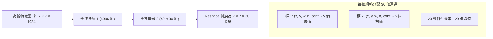

# 密集預測頭 (Dense Prediction Heads) 機制與網格回歸

## 1. 初學者導讀 (Beginner-Friendly Intuition)
> **棋盤插旗比喻**：
> 傳統的 Two-stage 預測頭（稀疏預測頭 Sparse Head）像是把挑選出來的 300 個小紙片單獨拿去蓋章；
> 而 **Dense Prediction Head（密集預測頭）** 則像是在整張地圖上畫好一張棋盤（如 $7 \times 7$ 網格）。每個格子都有專人留守，在同一瞬間同時插上預測旗幟。沒有任何中介流程，全圖成百上千個點一次性全體出結果，這就是單階段檢測極速的秘密！

---

## 2. 前代瓶頸與演進動機 (Evolution & Motivation)
- **Sparse Head 瓶頸**：Faster R-CNN 的 RoI Head 必須等待 RPN 篩選出候選框後，逐個進行 RoI Pooling 和全連接層運算。這種「串列依賴」導致計算難以高度平行化。
- **Dense Head 突破**：YOLOv1 創立了密集網格迴歸頭，直接在卷積特徵圖的空間採樣點上同時預測所有類別與邊界框座標，將運算完全轉化為可高度平行化的矩陣張量運算 [Redmon et al., 2016]。

---

## 3. 網格密集回歸的運作架構 (Grid Regression Architecture)

---

## 4. 密集預測頭的優劣勢分析 (Trade-offs)
| 維度 | 優勢 | 劣勢 / 局限性 |
| :--- | :--- | :--- |
| **運算效率** | 單次前向矩陣運算，極度適配 GPU 平行加速，推論延遲極低（$\ge 45$ FPS） | 缺乏候選區域特徵精修（RoIAlign），邊界框定位精準度粗糙 |
| **全域上下文** | 預測時直接看到全圖背景特徵，大幅降低背景誤檢（False Positives） | 早期全連接層密集頭參數繁重，限制了輸入影像解析度的動態調整 |
| **密集目標適應** | 每個網格只負責有限數量的目標，在稀疏場景極為乾淨俐落 | 面對成群、密集的同類小物體（如鳥群、人潮）存在先天漏檢限制 |

---

## 5. 簡報重點提煉 (Slide-Ready Key Takeaways)
- **核心架構**：從 RoI 逐框預測轉向全圖網格一次性密集預測。
- **推論優勢**：極致硬體親和性，徹底釋放 GPU 張量運算效能。
- **演進路徑**：全連接 Dense Head（YOLOv1） $\to$ 全卷積 Dense Head（YOLOv2/v3, RetinaNet） $\to$ 解耦頭 Decoupled Head（YOLOv6/v8/v10）。
