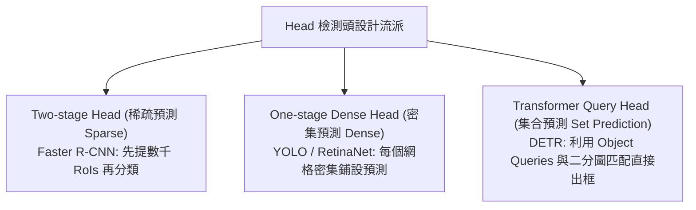

# 檢測頭與預測機制總覽 (Heads & Prediction Overview)

## 1. 初學者導讀 (Beginner-Friendly Intuition)
> **法庭上的法官比喻**：Backbone 與 Neck 整理好了所有現場搜集來的證物與特徵報告。現在輪到 **Head（檢測頭）** 做裁決。
> Head 必須在幾毫秒內回答兩個問題：
> 1. **「嫌疑人在哪裡？」**：畫出一個精準的方框（座標迴歸 Regression）。
> 2. **「嫌疑人犯了什麼罪名？」**：判定它屬於貓、狗、汽車還是行人（類別機率預測 Classification）。

---

## 2. 檢測頭的核心輸出格式 (Output Format)
檢測頭通常由卷積層（Conv layers）或全連接層（FC layers）構成，針對特徵圖上的每個採樣點輸出預測向量：

- **邊界框座標（Bounding Box Coordinates）**：通常包含 4 個數值 $(x, y, w, h)$，代表物體中心點座標與邊界寬高（或相對於預設框 Anchor 的偏移量 $\Delta x, \Delta y, \Delta w, \Delta h$）。
- **目標置信度（Objectness Score / Confidence）**：判斷此區域「究竟有沒有物體存在」的機率（0 到 1）。
- **類別機率分佈（Class Probabilities）**：若有 $C$ 個類別，輸出該物體屬於每個具體類別的機率分佈 $(p_1, p_2, ..., p_C)$。

---

## 3. 檢測頭的三大主流流派 (Three Main Head Paradigms)

### 三大流派架構對比
| 檢測頭類型 | 代表模型 | 候選區域生成方式 | 運算複雜度與延遲 | 適用情境 |
| :--- | :--- | :--- | :--- | :--- |
| **Two-stage (Sparse)** | Faster R-CNN, Mask R-CNN | 由 RPN 提出約 1000~2000 個候選區域，經 RoI Pooling 精細預測 | 較高（需對各 RoI 獨立重複運算） | 追求高精度、計算資源充裕的醫學或工業質檢 |
| **One-stage (Dense)** | YOLO 系列, SSD, FCOS | 直接在特徵圖的成千上萬個網格/錨點上密集預測 | 極低（單次前向傳播矩陣運算） | 自動駕駛、即時影片監控、手機端運算 |
| **Transformer Head** | DETR, Deformable DETR | 使用固定的可學習 Object Queries 直接輸出最終無重複的框 | 中等（自注意力運算開銷，但無需 NMS） | 端到端直接預測、免去手動後處理門檻 |

---

## 4. 簡報重點提煉 (Slide-Ready Key Takeaways)
- **職責**：將抽象的高維特徵圖，轉化為幾何框與語義類別的直接數值。
- **雙重任務解耦**：現代檢測頭常採用 Decoupled Head（解耦頭）設計，將「分類分支」與「回歸分支」分開計算，避免兩者特徵互相干擾。
- **演進趨勢**：從 Two-stage 的複雜候選框裁剪，走向 One-stage 的極速密集迴歸，再到 Transformer Head 的端到端集合預測。
