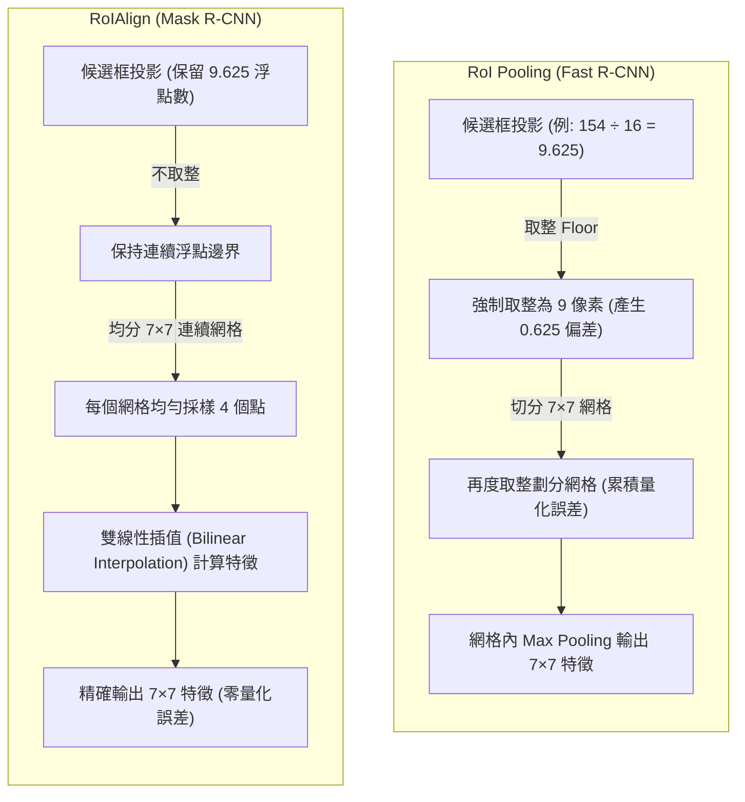

# 候選區域特徵採樣：RoI Pooling 與 RoIAlign 機制剖析

## 1. 初學者導讀 (Beginner-Friendly Intuition)
> **裁布師傅的比喻**：
> 全連接層（FC layer）就像一個固定尺寸（例如 $7 \times 7$）的標準盒子，只能塞進規格一致的布料。但每張照片裡的物體尺寸五花八門（有的長條、有的扁平、有的大、有的小）。
> - **R-CNN 的做法（暴力硬拉）**：不管布料原本長怎樣，用熱水縮水或硬扯變形（Warping），物體全變形了。
> - **RoI Pooling（粗暴格線剪裁）**：在布料上硬畫出 $7 \times 7$ 個格子，遇到小數點直接「無條件捨去取整數」。這會導致裁下來的邊緣缺了一角（像素級偏差）。
> - **RoIAlign（高精度雷射取樣）**：不用整數格子，直接用連續浮點數座標，在每個小格子內取 4 個微小取樣點做「雙線性平滑內插」，絲毫不差！

---

## 2. 前代瓶頸與演進動機 (Evolution & Motivation)
1. **R-CNN 痛點**：將不同長寬比的圖像區域強行扭曲（Warping）為固定大小，造成嚴重的幾何失真與特徵資訊丟失。
2. **Fast R-CNN 突破（RoI Pooling）**：直接在全圖共享特徵圖上採樣，無須形變影像。
3. **Fast/Faster R-CNN 殘存痛點（Quantization Misalignment）**：RoI Pooling 經歷兩次向下取整（Feature Stride 取整 + Bin 劃分取整），在特徵圖上僅僅 0.5 像素的偏移，放大回原始圖像（經過 16 倍或 32 倍降採樣）就會造成數個甚至數十個像素的空間錯位。這對粗粒度的邊界框影響尚可接受，但對**像素級分割（Instance Segmentation）是致命缺陷**。
4. **Mask R-CNN 突破（RoIAlign）**：捨棄取整，採用雙線性插值，特徵對齊精度達亞像素（Sub-pixel）級別 [He et al., 2017]。

---

## 3. 機制對比圖解：RoIPool vs. RoIAlign

---

## 4. 客觀技術特點對照表

| 比較維度 | RoI Pooling (Fast R-CNN) | RoIAlign (Mask R-CNN) | 資訊來源 |
| :--- | :--- | :--- | :--- |
| **座標處理方式** | 強制向下取整（$\lfloor x/16 \rfloor$ Quantization） | 完全保留連續浮點數（Continuous Coordinates） | [He et al., 2017; Lilian Weng, 2017] |
| **特徵聚合方式** | 網格內所有整數像素取 Max Pooling | 每個網格內均勻取 4 個取樣點進行雙線性插值後 Pooling | [He et al., 2017; Lilian Weng, 2017] |
| **空間對齊精度** | 存在最大可達數十像素的積累誤差 | 亞像素級精確對齊（Sub-pixel Alignment） | [He et al., 2017] |
| **COCO 邊界框 AP 提升** | 基準 | 約提升 +1.1 點 AP（純靠 RoIAlign 帶來的增益） | [He et al., 2017, 表 2c] |
| **支援任務** | 物件偵測（邊界框） | 物件偵測 + 實例分割（Instance Segmentation） | [He et al., 2017] |

---

## 5. 簡報重點提煉 (Slide-Ready Key Takeaways)
- **RoIPool 的歷史功績**：消除了 R-CNN 時代影像暴力扭曲的缺點，實現共享特徵圖採樣。
- **RoIAlign 的精度革命**：用「雙線性插值」終結了量化取整帶來的空間失準，成為後續高精度 Two-stage 模型與分割模型的金科玉律。
