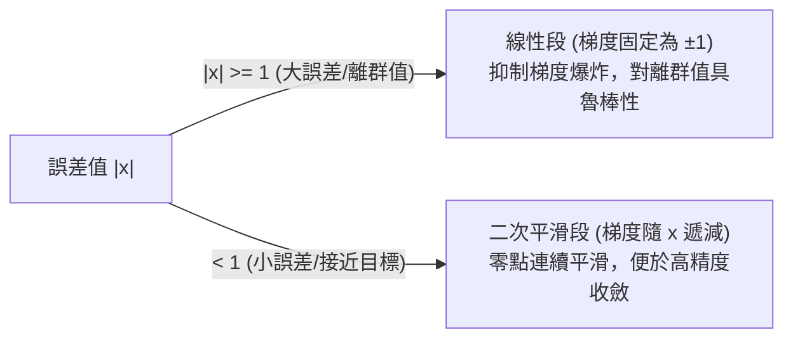

# 平滑 L1 損失函數 (Smooth L1 Loss) 機制與數學分析

## 1. 初學者導讀 (Beginner-Friendly Intuition)
> **老師批改考卷的比喻**：
> 當神經網路預測邊界框時，就像學生在算數學題：
> - **L2 Loss（超嚴厲處罰）**：如果學生粗心大意算差了一點點，扣分很輕；但如果學生某題猜錯離譜（離群值 Outlier），分數直接平方乘暴增扣到負幾千分！這會導致神經網路被少數幾個極端錯誤嚇傻，整個訓練直接崩潰（梯度爆炸）。
> - **L1 Loss（死板處罰）**：不管算差很多還是一點點，扣分都一樣死板。在接近滿分時，神經網路會因為左右微調震盪而難以精確穩定收斂。
> - **Smooth L1 Loss（因材施教的溫柔導師）**：離答案很遠時，採用 L1 溫和對待（梯度固定為 $\pm 1$，不被極端值綁架）；離答案很近時，平滑切換成 L2（梯度逐漸縮小至 0，精細穩妥微調）。

---

## 2. 前代瓶頸與演進動機 (Evolution & Motivation)
在 Fast R-CNN 之前，邊界框迴歸常使用傳統的均方誤差（$L_2$ Loss）。但在物件偵測訓練初期，未經過濾的候選框座標誤差極大，容易產生極大數值的離群值（Outliers）。$L_2$ 損失的二次方特徵會產生極為巨大的梯度值，引發梯度爆炸並破壞主網絡特徵權重。

---

## 3. 數學定義與公式拆解 (Mathematical Formulation)

Ross Girshick (2015) 在 Fast R-CNN 中提出了平滑化設計：

$$\text{smooth}_{L_1}(x) = \begin{cases} 0.5 x^2 & \text{if } |x| < 1 \\ |x| - 0.5 & \text{otherwise} \end{cases}$$

其對應的一階導數（梯度）：

$$\frac{d}{dx} \text{smooth}_{L_1}(x) = \begin{cases} x & \text{if } |x| < 1 \\ \text{sign}(x) & \text{otherwise} \end{cases}$$

---

## 4. 三大迴歸損失函數客觀對比

| 損失函數 | 小誤差區間行爲 ($|x| < 1$) | 大誤差區間行爲 ($|x| \ge 1$) | 梯度在零點特性 | 訓練穩定性 | 資訊來源 |
| :--- | :--- | :--- | :--- | :--- | :--- |
| **L1 Loss** ($|x|$) | 線性懲罰 | 線性懲罰 | 零點不可導（易震盪） | 普通 | [Girshick, 2015] |
| **L2 Loss** ($x^2$) | 二次方平滑懲罰 | 二次方巨額懲罰 | 零點平滑連續 | 差（易受離群值影響爆炸） | [Girshick, 2015] |
| **Smooth L1** | **二次方平滑 ($0.5x^2$)** | **線性懲罰 ($|x|-0.5$)** | **零點連續平滑可導** | **極佳（兼顧平滑與魯棒性）** | [Girshick, 2015; Lilian Weng, 2017] |

---

## 5. 限制與後續演進 (Limitations & Next Steps)
雖然 Smooth L1 在數值回歸上大幅提升了穩定性，但它將邊界框的 4 個座標 $(x, y, w, h)$ 當作**獨立變數**分開計算。然而在幾何空間中，這 4 個數值具有強烈關聯性（例如寬高縮放與中心位移是互相影響的）。這項局限在後續促成了**直接計算重疊面積的 IoU 系列損失（GIoU, DIoU, CIoU）**的誕生。

---

## 6. 簡報重點提煉 (Slide-Ready Key Takeaways)
- **設計哲學**：小誤差看 L2（細膩收斂）、大誤差看 L1（不被離群值綁架）。
- **核心收益**：解決了神經網絡聯合訓練多任務時，座標迴歸分支梯度爆炸的問題。
- **歷史地位**：Fast R-CNN 與 Faster R-CNN 邊界框迴歸的標準損失函數。
