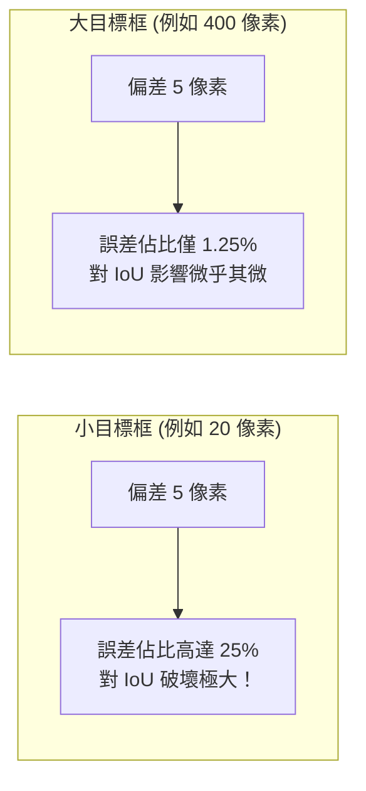

# YOLOv1 多部分加權均方誤差損失函數 (Multi-Part SSE Loss) 詳解

## 1. 初學者導讀 (Beginner-Friendly Intuition)
> **多項全能教練的比喻**：
> YOLOv1 要同時學習三件事：
> 1. 座標不能畫歪（幾何定位）。
> 2. 有沒有物體不能看走眼（置信度）。
> 3. 是貓還是狗不能認錯（分類）。
> 但問題來了：一張照片裡絕大部分網格都是空無一物的「純背景」。如果每塊背景網格算錯一點點都全力扣分，總分加起來會把「貓狗」的微小訊號完全淹沒！
> 聰明的教練設定了**加權天平**：
> - 畫框定位特別重要：分數放大 5 倍（$\lambda_{\text{coord}} = 5$）！
> - 背景沒物體太常見了：處罰縮小到 0.1 倍（$\lambda_{\text{noobj}} = 0.5$），避免背景搶走焦點！

---

## 2. 完整損失函數公式拆解 (Mathematical Formulation)

Joseph Redmon 等人在 YOLOv1 中統一採用均方和誤差（Sum-Squared Error, SSE），並將損失切分為五大項：

$$\begin{aligned}
\mathcal{L}_{\text{YOLOv1}} &= \underbrace{\lambda_{\text{coord}} \sum_{i=0}^{S^2} \sum_{j=0}^{B} \mathbb{I}_{ij}^{\text{obj}} \left[ (x_i - \hat{x}_i)^2 + (y_i - \hat{y}_i)^2 \right]}_{\text{項 1: 中心點座標誤差}} \\
&\quad + \underbrace{\lambda_{\text{coord}} \sum_{i=0}^{S^2} \sum_{j=0}^{B} \mathbb{I}_{ij}^{\text{obj}} \left[ (\sqrt{w_i} - \sqrt{\hat{w}_i})^2 + (\sqrt{h_i} - \sqrt{\hat{h}_i})^2 \right]}_{\text{項 2: 寬高開根號誤差}} \\
&\quad + \underbrace{\sum_{i=0}^{S^2} \sum_{j=0}^{B} \mathbb{I}_{ij}^{\text{obj}} (C_i - \hat{C}_i)^2}_{\text{項 3: 含物體網格之置信度誤差}} \\
&\quad + \underbrace{\lambda_{\text{noobj}} \sum_{i=0}^{S^2} \sum_{j=0}^{B} \mathbb{I}_{ij}^{\text{noobj}} (C_i - \hat{C}_i)^2}_{\text{項 4: 純背景網格之置信度抑制誤差}} \\
&\quad + \underbrace{\sum_{i=0}^{S^2} \mathbb{I}_{i}^{\text{obj}} \sum_{c \in \text{classes}} (p_i(c) - \hat{p}_i(c))^2}_{\text{項 5: 類別條件機率誤差}}
\end{aligned}$$

---

## 3. 三大關鍵設計細節客觀剖析

### 3.1 為什麼要設定 $\lambda_{\text{coord}} = 5$ 與 $\lambda_{\text{noobj}} = 0.5$？
- **背景壓倒性多數**：在 $7 \times 7 = 49$ 個網格中，通常只有 2~3 個網格含有目標物體，其餘 46 個全是背景。
- **防止梯度淹沒**：若權重均為 1，背景網格的信心度梯度將以數十倍的力量壓倒前景目標，使神經網絡直接趨向於將所有網格信心度輸出為 0。
- **解法**：加大定位損失權重（5.0），同時縮小無物體背景損失權重（0.5）[Redmon et al., 2016]。

### 3.2 為什麼寬高要開根號 $(\sqrt{w} - \sqrt{\hat{w}})^2$？

- 若直接使用 $(w - \hat{w})^2$，偏差 5 像素時，大框和小框的懲罰完全一樣，這顯然不符合視覺直覺。
- 開根號後，斜率在數值小時更陡峭，使得**小物體的微小尺寸偏差會受到更嚴厲的懲罰** [Redmon et al., 2016]。

---

## 4. 客觀局限與演進 (Limitations)
- **SSE 的理論缺陷**：用均方誤差（SSE）處理分類機率（應使用交叉熵 Cross-Entropy）與長寬幾何（應直接優化 IoU）並不理想。
- **後續突破**：YOLOv3 引入了二元交叉熵（BCE Loss），後續版本全面採用直接計算面積交併比的 IoU Loss、GIoU、CIoU 等幾何損失函數。

---

## 5. 簡報重點提煉 (Slide-Ready Key Takeaways)
- **加權天平**：$\lambda_{\text{coord}} = 5$ 強化定位，$\lambda_{\text{noobj}} = 0.5$ 抑制背景雜訊干擾。
- **根號技巧**：用 $\sqrt{w}, \sqrt{h}$ 緩解大框與小框對尺寸敏感度的物理差異。
- **歷史意義**：首個將檢測的多個目標統一在單一純數值公式下端到端訓練的損失函數。
