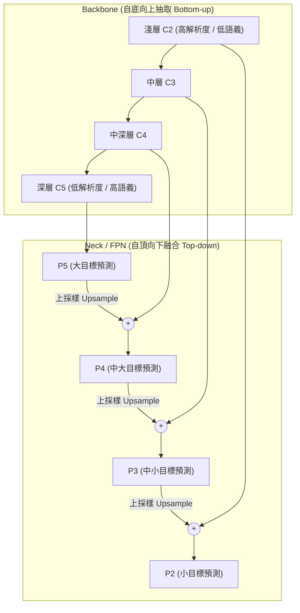

# 特徵融合層總覽 (Necks / Feature Fusion Overview)

## 1. 初學者導讀 (Beginner-Friendly Intuition)
> **空照圖與顯微鏡的結合比喻**：
> - 如果你只看「空照圖」（深層特徵），你可以輕易看出一整座森林的輪廓（辨識大物體或全域語義），但你完全看不見樹下有沒有一隻松鼠（小物體被模糊掉了）。
> - 如果你只用「放大鏡」（淺層特徵），你能看清松鼠身上的每一根毛（精細幾何細節），但你看不到牠到底在哪座森林裡（缺乏全局語義）。
> - **Neck 的作用就是架起一座天橋**：把空照圖的宏觀理解，傳遞給放大鏡的細節特徵，讓模型無論對遠處的小松鼠還是眼前的大貨車都能同時看懂看準！

---

## 2. 前代瓶頸與演進動機 (Evolution & Motivation)
- **單一特徵層預測的致命缺陷**：早期偵測器（如 YOLOv1、傳統 Fast R-CNN）直接使用 Backbone 最後一層特徵進行預測。然而最後一層特徵圖經過多次下採樣（Downsampling，如降採樣 32 倍），原本在圖像上只有 $16 \times 16$ 像素的小物體，在特徵圖上連 1 個像素都不到，造成**小物體偵測性能極差**。
- **演進突破點**：引入特徵金字塔網絡（Feature Pyramid Network, FPN）等多尺度融合結構，將不同深度的特徵圖跨層相加或拼接（Concat）。

---

## 3. 核心機制圖解 (Top-down & Multi-scale Fusion)

---

## 4. 經典特徵融合架構演進比對
| 架構名稱 | 融合方向 / 機制特點 | 解決的瓶頸 | 演進意義 |
| :--- | :--- | :--- | :--- |
| **無 Neck**（直接接 Head） | 僅依賴最深層特徵 | - | 早期架構（如 YOLOv1），小物體定位極度困難 |
| **FPN** (Feature Pyramid Network) | 自頂向下（Top-down）傳遞深層語義 | 讓高解析度淺層特徵獲得強語義 | 現代物件偵測的標配基石 |
| **PANet** (Path Aggregation Network) | 增加自底向上（Bottom-up）的二次增強路徑 | 縮短淺層幾何定位資訊向頂層傳遞的路徑 | 被 YOLOv4、YOLOv5 廣泛採用 |
| **BiFPN** (Bidirectional FPN) | 雙向加權融合 + 跨尺度跳躍連接 | 克服各尺度特徵權重均等的不合理假設 | EfficientDet 的核心創新 |

---

## 5. 簡報重點提煉 (Slide-Ready Key Takeaways)
- **Neck 的核心使命**：解決尺度多樣性問題（Scale Invariance），實現「大物體看深層、小物體看淺層」。
- **主流範式**：FPN（自頂向下語義賦能）與 PANet（雙向循環補強幾何細節）。
- **管線位置**：承接 [Backbone](../backbones/overview.md) 輸出的多級特徵，加工後餵入 [Head](../heads/overview.md)。
