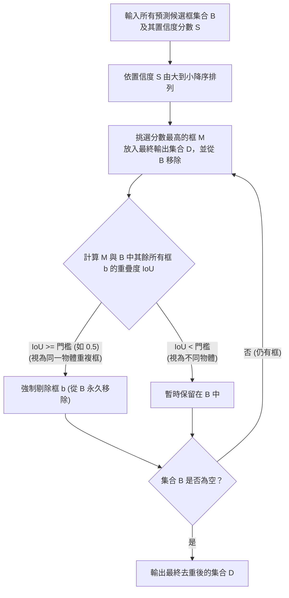

# 非極大值抑制 (Non-Maximum Suppression, NMS) 演算法詳解

## 1. 初學者導讀 (Beginner-Friendly Intuition)
> **相機連拍挑照片比喻**：
> 當你幫朋友拍照時，相機高速連拍了 20 張角度幾乎一模一樣的照片。你不會把 20 張全發到社群平台，而是：
> 1. 先挑出「笑容最好、分數最高（置信度最高）」的那張保留下來。
> 2. 將其他 19 張跟這張精選照高度重疊（IoU 高於門檻）的照片直接刪除。
> 3. 接著在剩下的不同場景照片中，重複上述篩選步驟。
> **這就是 NMS 的核心任務**：掃除同一物體周圍成百上千個重複多餘的預測框！

---

## 2. 前代瓶頸與演進動機 (Evolution & Motivation)
物件偵測模型（無論是 Two-stage 的 RPN 還是 One-stage 的密集網格）為了避免漏檢，會在物體周圍密集生成大量預測框。這導致同一個物體（例如一輛車）會被畫上 50 個位置微小偏移的框。如果沒有後處理演算法進行壓制，檢測結果將完全無法供後續系統使用。

---

## 3. 標準 NMS 演算法執行步驟 (Algorithmic Steps)

---

## 4. 客觀局限與演進瓶頸 (Limitations & Failure Cases)
標準 NMS 雖然簡單高效，但具有兩個與生俱來的結構性缺陷：

1. **密集遮擋場景的「誤刪悲劇」**：
   - 當兩個同類別物體緊密靠在一起（例如騎機車雙載、密集人群擁擠），物體 A 與物體 B 的真實邊界框重疊度非常高（$\text{IoU} > 0.5$）。
   - NMS 在保留分數較高的物體 A 後，會將原本正確標註物體 B 的框**硬性誤判為重複框而直接刪除**，導致嚴重的漏檢！
2. **不可導性（Non-differentiable）**：
   - NMS 包含貪婪排序與離散過濾邏輯，無法計算反向傳播梯度，無法直接納入神經網路端到端訓練。

---

## 5. 後續技術突破伏筆 (Evolutionary Outlook)
為了解決 NMS 的上述瓶頸，後續學界催生了兩大創新方向：
- **Soft-NMS**（Bodla et al., 2017）：不直接將重疊框粗暴刪除，而是根據重疊度高低連續「衰減其置信度分數」，大幅改善遮擋情境。
- **End-to-End NMS-free 架構**：
  - **DETR**（Carion et al., 2020）：利用 Hungarian Matching（匈牙利二分圖匹配）實現一對一直接集合預測，徹底擺脫 NMS。
  - **YOLOv10**（Wang et al., 2024）：引入雙標籤分配機制（Dual Label Assignment），實現極致低延遲的 NMS-free 即時偵測。

---

## 6. 簡報重點提煉 (Slide-Ready Key Takeaways)
- **NMS 核心任務**：基於「局部置信度最高」原則，利用 IoU 門檻消除同一目標的重複重疊框。
- **致命弱點**：在高度重疊的遮擋場景容易誤刪真實目標；且不可導、難以端到端優化。
- **演進方向**：Soft-NMS（軟性衰減） $\to$ Transformer/DETR（無 NMS 端到端直接出框）。
