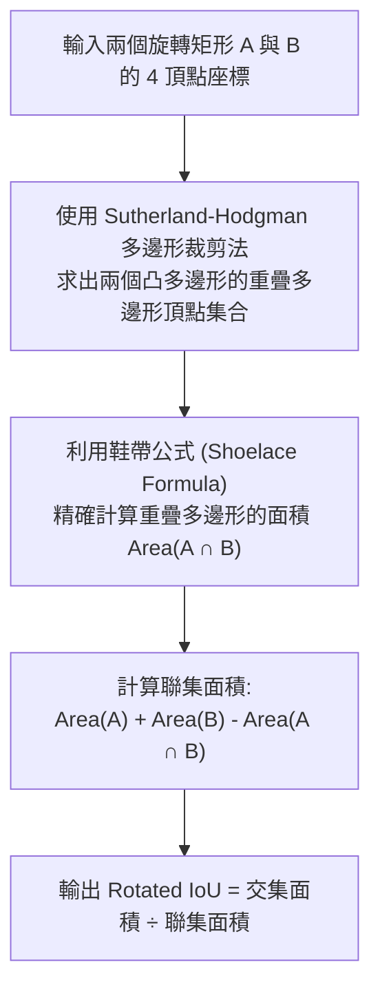

# 旋轉非極大值抑制 (Rotated NMS) 與旋轉交併比 (Rotated IoU)

## 1. 初學者導讀 (Beginner-Friendly Intuition)
> **斜插多雙筷子的比喻**：
> 想像桌上緊密並排插著 5 雙斜向 45 度的長筷子。
> - **傳統標準 NMS（看水平大影子）**：它不看筷子本身，只看筷子投在牆上的「水平大投影」。由於每雙筷子斜插的位置很近，它們的水平投影幾乎完全重疊在一塊。傳統 NMS 判定：「這是一大團重複的東西！」一口氣把 4 雙筷子全刪了，只剩 1 雙。
> - **Rotated NMS（看筷子真實本體）**：它帶著旋轉幾何尺量測筷子真實的旋轉交疊。它發現每雙筷子雖然靠得很近，但筷身之間根本沒有撞在一起（Rotated IoU 幾乎為 0）。於是 5 雙筷子全數安全保留！

---

## 2. 前代瓶頸與演進動機 (Evolution & Motivation)
在標準 NMS 中，計算交集面積依賴簡單的邊界點最小/最大值：
$$\text{Intersection} = \max(0, \min(x_2^{(A)}, x_2^{(B)}) - \max(x_1^{(A)}, x_1^{(B)})) \times \max(0, \min(y_2^{(A)}, y_2^{(B)}) - \max(y_1^{(A)}, y_1^{(B)}))$$
但對於兩個旋轉了一定角度的矩形，它們的邊界不再平行於座標軸，直接使用水平座標計算重疊會嚴重失真，把鄰近的非重疊目標判定為高 IoU，進而在 NMS 階段引發致命的**漏檢誤刪**。

---

## 3. 旋轉交併比 (Rotated IoU) 計算原理

計算兩個旋轉矩形 $A$ 與 $B$ 的交集，本質上是計算**凸多邊形相交（Convex Polygon Intersection）**：

---

## 4. 客觀性能與計算開銷對比

| 指標維度 | 標準水平 NMS (Standard NMS) | 旋轉 NMS (Rotated NMS) | 資訊來源 |
| :--- | :--- | :--- | :--- |
| **輸入參數** | 4 參數 $(x_1, y_1, x_2, y_2)$ | 5 參數 $(x, y, w, h, r)$ 或 8 頂點 | [Ultralytics, 2024] |
| **交集計算演算法** | 簡單座標比較（極快，可高度向量化） | 凸多邊形裁剪 + 三角形剖分（計算量較大） | [Ultralytics, 2024] |
| **密集斜向目標召回率** | 極差（嚴重互相誤刪） | **極佳（精準保留密集相鄰目標）** | [Ultralytics, 2024] |
| **後處理延遲** | 微秒級（< 1 ms） | 毫秒級（約 2~5 ms，通常需 CUDA 算子加速） | [Ultralytics, 2024] |

---

## 5. 簡報重點提煉 (Slide-Ready Key Takeaways)
- **演進必然性**：解決細長目標密集傾斜排列時，標準 NMS 互相誤殺的致命缺陷。
- **演算法核心**：利用 Sutherland-Hodgman 多邊形求交技術計算真實的 Rotated IoU。
- **工程取捨**：以略微增加的後處理幾何計算時間，換取密集場景召回率的巨大飛躍。
