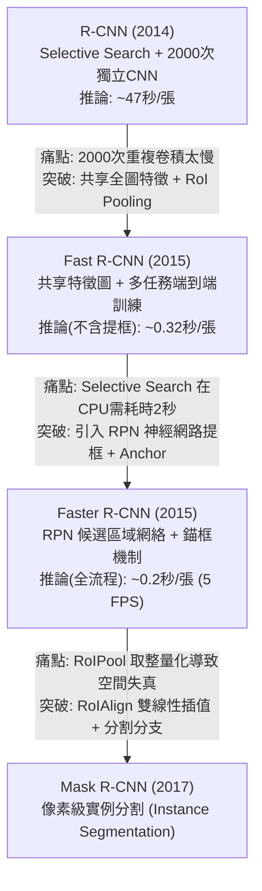

# R-CNN 家族演進史：從 R-CNN、Fast R-CNN、Faster R-CNN 到 Mask R-CNN

## 1. 初學者導讀 (Beginner-Friendly Intuition)
> **影印店辦公演進比喻**：
> - **R-CNN（純手工搬運工）**：老闆給你一張大合照，你用剪刀剪下 2,000 張可能有人臉的碎紙片。接著你親手把這 2,000 張碎紙片一張張送進影印機掃描 2,000 次！慢到令人抓狂（一張照片要 47 秒）。
> - **Fast R-CNN（共享掃描檔）**：聰明的員工想通了：「為什麼不先把整張大合照掃描成一份高畫質電子檔？」大家直接在電子檔上圈出 2,000 個區塊（RoI Pooling）。但美中不足的是，找那 2,000 個區塊還是得用手工作業（Selective Search 依然耗時 2 秒）。
> - **Faster R-CNN（全自動神經網路秘書）**：老闆請了一個 AI 秘書（RPN）。從找可疑區域到最後辨識身份，全部交由神經網路一條龍全自動完成，速度暴增到 0.2 秒（接近即時推論）！

---

## 2. 前代瓶頸與演進動機 (Evolution & Motivation)

---

## 3. 四代架構技術細節拆解 (Core Mechanisms)

### 3.1 第一代：R-CNN (Girshick et al., CVPR 2014)
- **核心流程**：
  1. 輸入影像，利用非監督分割演算法 **Selective Search** 抓出約 2,000 個候選區域（Region Proposals / RoIs）。
  2. 強制將每個候選框扭曲縮放（Warping）為 $227 \times 227$ 固定尺寸。
  3. 將 2,000 個區域分別送入 CNN（AlexNet）抽取 4,096 維特徵向量。
  4. 針對每個類別訓練一個二元 SVM 判斷類別。
  5. 訓練線性 Ridge Regression 修正邊界框座標 $(\Delta x, \Delta y, \Delta w, \Delta h)$。
  6. 透過 [NMS (非極大值抑制)](../concepts/postprocessing/nms.md) 剔除重疊冗餘框。
- **致命痛點**：
  - **極度重複計算**：候選框高度重疊，特徵被重複抽取 2,000 次，GPU 推論一張需 **47 秒**。
  - **多階段繁瑣訓練**：CNN 微調、SVM 訓練、Bounding-box 回歸分開進行，無法聯合反向傳播。

---

### 3.2 第二代：Fast R-CNN (Girshick, ICCV 2015)
- **核心突破點**：
  1. **共享特徵圖（Shared Conv Feature Map）**：整張影像只通過一次 CNN，生成高維特徵圖。
  2. **[RoI Pooling](../concepts/heads/roi-pooling-and-align.md)**：將 Selective Search 提出的框映射到特徵圖上，均勻切分成 $H \times W$（如 $7 \times 7$）網格做 Max Pooling，輸出固定維度，徹底免除影像 Warping 失真。
  3. **多任務聯合損失（Multi-task Loss）**：端到端整合分類（Softmax）與座標迴歸，並採用 [Smooth L1 Loss](../concepts/losses/smooth-l1.md) 抑制離群值。
- **殘餘瓶頸**：
  - 檢測神經網路只需 0.32 秒，但前面的 **Selective Search 仍需在 CPU 上運算 2~2.3 秒**，成為整個管線無法逾越的速度瓶頸。

---

### 3.3 第三代：Faster R-CNN (Ren et al., NIPS 2015)
- **核心突破點**：
  1. **[RPN (Region Proposal Network)](../concepts/assignment/rpn.md)**：設計小型全卷積網路在共享特徵圖上滑動，直接預測物體存在機率與粗略邊界框。
  2. **[Anchor Boxes（錨框機制）](../concepts/assignment/rpn.md)**：在每個特徵圖點預設 $k=9$ 個多尺度（$128^2, 256^2, 512^2$）、多長寬比（$1:1, 1:2, 2:1$）的參考框，神經網路僅需學習預測相對位移量。
  3. **正負樣本分配（IoU 匹配）**：與 Ground Truth 的 IoU > 0.7 設為正樣本，IoU < 0.3 設為負樣本。
- **成果**：候選框生成時間從 2,000 ms 驟降至 **10 ms**，全流程推論時間僅需 **0.2 秒（約 5 FPS）**。

---

### 3.4 第四代：Mask R-CNN (He et al., ICCV 2017)
- **核心突破點**：
  1. **[RoIAlign 取代 RoIPool](../concepts/heads/roi-pooling-and-align.md)**：RoIPool 兩次座標「向下取整（Floor）」導致空間特徵與原始框產生像素級偏差；RoIAlign 保留浮點數座標，利用**雙線性插值（Bilinear Interpolation）**保持精準對齊。
  2. **並行分割分支（FCN Mask Branch）**：在分類與回歸分支旁新增像素級遮罩預測分支，實現 SOTA 的實例分割（Instance Segmentation）。

---

## 4. 實驗數據與客觀依據 (Empirical Evidence)

以下數據摘錄自原文實驗結果（測試硬體環境：Nvidia K40 GPU，測試資料集：PASCAL VOC 2007）：

| 模型名稱 | 候選區域產生方式 | 訓練時間 (小時) | 測試時間 (秒/張) | 推論速度提升倍數 | VOC 2007 mAP | 資訊來源 |
| :--- | :--- | :--- | :--- | :--- | :--- | :--- |
| **R-CNN** | Selective Search (CPU) | 84 hr | 47.0 s | 1x（基準） | 66.0% | [Girshick et al., 2014; Lilian Weng, 2017] |
| **Fast R-CNN** | Selective Search (CPU) | 9.5 hr | 2.3 s *(純網路 0.32s)* | 20x | 70.0% | [Girshick, 2015; Lilian Weng, 2017] |
| **Faster R-CNN** | **RPN (GPU 神經網路)** | **4.0 hr** | **0.2 s** | **235x** | **73.2%** | [Ren et al., 2015; Lilian Weng, 2017] |

---

## 5. 限制與權衡 (Trade-offs & Contradictions)
- **客觀事實**：Faster R-CNN 將物件偵測速度推升至 0.2 秒/張（約 5 FPS），但在自動駕駛等需要即時視訊處理（通常要求 $\ge 30$ FPS）的高延遲敏感場景中，5 FPS 依然無法滿足「Real-time」標準。
- **演進伏筆**：這項速度局限直接催生了後續拋棄候選區域的 **One-stage 典範（如 YOLO 原始論文 45 FPS）**，正式拉開了 Two-stage vs One-stage 長達十年的競逐。

---

## 6. 簡報重點提煉 (Slide-Ready Key Takeaways)
- **演進核心思想**：從「重複計算」到「特徵共享（Fast R-CNN）」，再到「神經網路自主提框（Faster R-CNN）」。
- **速度分水嶺**：47s（R-CNN） $\to$ 2.3s（Fast R-CNN，卡在 CPU Selective Search） $\to$ 0.2s（Faster R-CNN，RPN 誕生）。
- **關鍵組件遺產**：RPN、Anchor Boxes、RoIPool/RoIAlign、Smooth L1 Loss，成為現代電腦視覺的經典模組。
