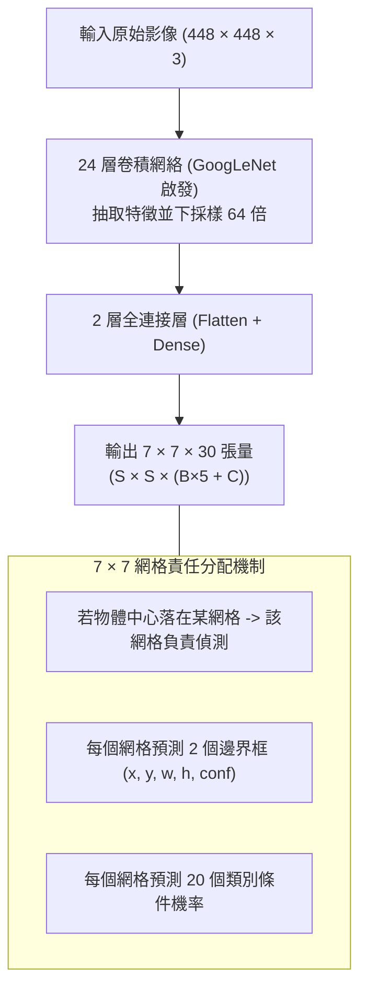

# YOLOv1：You Only Look Once 單階段即時物件偵測開山之作

## 1. 初學者導讀 (Beginner-Friendly Intuition)
> **登高遠眺的瞭望守衛比喻**：
> - **Two-stage（如 Faster R-CNN）**：像一位細心的偵探。他先走遍整個房間，拿著放大鏡圈出 300 個「可疑痕跡」（候選框），然後再逐一拿出圖鑑核對每個痕跡到底是不是罪證。雖然精確，但走完整個房間要花好幾秒。
> - **YOLOv1（登高遠眺的瞭望守衛）**：守衛站在高塔上，直接將整片平原用眼光劃分成 $7 \times 7 = 49$ 塊農田（網格）。他一眼看去（You Only Look Once），瞬間同時大喊：「第 3 塊田有一頭牛、第 24 塊田有一輛馬車！」
> 雖然守衛偶爾會把方框畫得有點歪（定位精度較粗糙），但他能在 **1 秒內掃描 45 次（45 FPS）**，即使馬車飛奔也逃不過他的眼睛！

---

## 2. 前代瓶頸與演進動機 (Evolution & Motivation)
在 YOLO 誕生前，物件偵測的主流是 R-CNN 家族。儘管 Faster R-CNN 將推論縮短到 0.2 秒（5 FPS），但依然面臨無法克服的結構性瓶頸：

- **痛點 1：無法滿足即時視訊處理（Real-time Processing）**  
  自動駕駛車輛、無人機避障、機器人即時操作普遍需要 $\ge 30$ FPS 的處理能力，5 FPS 會造成致命的反應延遲。
- **痛點 2：管線繁複、缺乏全域視野（Global Context）**  
  Two-stage 分開產生候選框與分類，候選框裁剪後丟失了周圍的全圖背景資訊，容易將背景雜訊（如一塊像狗的草地）誤判為物體。
- **演進突破點**：  
  Joseph Redmon 等人大膽拋棄「先候選、再分類」的兩步走思維，將物件偵測重塑為**單一迴歸問題（Single Regression Problem）**，在單次前向傳播中直接輸出全圖所有的座標與類別！

---

## 3. 核心架構與網格機制 (Core Mechanism)

### 3.1 網格切分與輸出維度拆解 ($7 \times 7 \times 30$)
- **網格尺寸 ($S \times S = 7 \times 7$)**：影像被均分為 49 個格子。
- **邊界框預測 ($B = 2$)**：每個格子預測 2 個候選框，每個框有 5 個參數：$(x, y, w, h, \text{confidence})$。
  - $(x, y)$：中心點相對於網格左上角的偏移量（$0 \sim 1$）。
  - $(w, h)$：相對於整張影像的寬高比例（$0 \sim 1$）。
  - $\text{confidence} = \text{Pr}(\text{Object}) \times \text{IoU}_{\text{pred}}^{\text{truth}}$。
- **類別條件機率 ($C = 20$)**：針對 PASCAL VOC 的 20 個類別預測機率 $\text{Pr}(\text{Class}_i | \text{Object})$。
- **單一網格預測長度**：$2 \times 5 + 20 = 30$ 數值；全圖總計輸出 $7 \times 7 \times 30 = 1470$ 個預測值。

---

## 4. 實驗數據與客觀依據 (Empirical Evidence)

以下數據摘錄自原文實驗表格（測試環境：Titan X GPU，評估基準：PASCAL VOC 2007 測試集）：

| 檢測器模型 | 卷積網絡骨幹 | 推論速度 (FPS) | 是否達到即時標準 ($\ge 30$ FPS) | VOC 2007 mAP | 資訊來源 |
| :--- | :--- | :--- | :--- | :--- | :--- |
| **Fast R-CNN** | VGG-16 | 0.5 FPS | 否 | 70.0% | [Girshick, 2015] |
| **Faster R-CNN** | VGG-16 | 7.0 FPS | 否 | **73.2%** | [Ren et al., 2015] |
| **Faster R-CNN** | ZF 網絡 | 18.0 FPS | 否 | 62.1% | [Ren et al., 2015] |
| **YOLO (標準版)** | 自研 24 層卷積 | **45.0 FPS** | **是 (即時)** | 63.4% | [Redmon et al., 2016, 表 1] |
| **Fast YOLO** | 精簡 9 層卷積 | **155.0 FPS** | **是 (極速)** | 52.7% | [Redmon et al., 2016, 表 1] |

---

## 5. 爭議、限制與客觀錯誤對比 (Contradictions & Trade-offs)

本知識庫嚴格並列論文原文第 4.2 節（Hoiem et al. 診斷分析工具）之實測對比，絕不做未經證實的推論：

### 客觀錯誤成分對比表 (VOC 2007 Error Analysis)
| 錯誤類型 | 定義與現象 | Fast R-CNN 佔比 | YOLOv1 佔比 | 原文客觀原因分析 |
| :--- | :--- | :--- | :--- | :--- |
| **背景誤檢錯誤** (Background Error) | 框在無物體的純背景上 ($\text{IoU} < 0.1$) | **13.6%**（顯著較高） | **4.75%**（顯著較低） | YOLO 具備**全圖全域視野（Global Context）**，能有效理解周圍環境，極少把背景雜訊誤認成物體；而 Fast R-CNN 的候選框裁剪丟失了全域上下文 [Redmon et al., 2016, 節 4.2]。 |
| **定位誤差** (Localization Error) | 類別正確但框未對準 ($0.1 < \text{IoU} < 0.5$) | **8.6%**（顯著較低） | **19.0%**（最主要弱點） | YOLO 缺乏類似 RoIAlign 的多階段精修機制，直接由全連接層粗暴回歸座標，定位精準度明顯劣於 Two-stage 偵測器 [Redmon et al., 2016, 節 4.2]。 |

### YOLOv1 的本質局限性
1. **密集小物體無力**：每個網格**只能預測一個類別**且最多輸出兩個框。如果一小群鳥落在同一個網格內，YOLO 只能偵測出其中一隻。
2. **長寬比泛化弱**：對於非典型比例或極端長寬比的物體，直接回歸不易收斂。
3. **特徵粗糙**：網絡歷經 64 倍下採樣，缺乏特徵金字塔融合，小物體特徵在深層全數流失。

---

## 6. 簡報重點提煉 (Slide-Ready Key Takeaways)
- **典範轉移**：將偵測問題從「繁複的多階段分類」轉變為「優雅的單一迴歸問題」。
- **即時性突破**：首個兼顧可用精度（63.4% mAP）與極致速度（45 FPS / Fast YOLO 155 FPS）的深度學習檢測器。
- **互補優勢**：YOLO 全域視野好（背景誤檢少），但定位粗糙；與 Fast R-CNN 集成後曾創下 75.0% 的 SOTA 紀錄。
