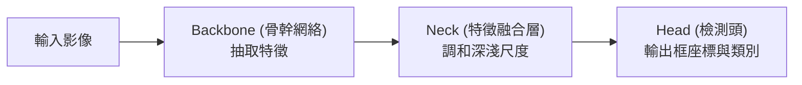

# 什麼是物件偵測？
## 從像素網格到現代通用檢測架構

**授課主題**：電腦視覺任務定義與通用管線解析  
**目標受眾**：深度學習與電腦視覺初學者  
**知識庫**：Object Detection LLMwiki  

---

# 1. 生活化理解：夜市照片的啟示

想像你在夜市拍了一張熱鬧的小吃照片：

- **影像分類 (Classification)**：
  - 「這張照片是*夜市*。」
  - *只給全圖單一標籤，不管裡面有幾樣東西、在哪裡。*
- **物件定位 (Localization)**：
  - 「中間這碗是*牛肉麵*，它的位置在螢幕正中央的方框裡。」
  - *只圈出單一主角的位置。*
- **物件偵測 (Object Detection)**：
  - 「同時圈出 3 碗牛肉麵、2 杯珍珠奶茶、5 位朋友、1 輛機車，並分別標上位置與名稱。」
  - *同時回答「是什麼 (What)」與「在哪裡 (Where)」的**多目標實例**任務！*

---

# 2. 為什麼純分類不夠？演進動機與實務痛點

### 傳統影像分類的致命瓶頸
1. **真實世界充滿多物體共存**：
   - 自動駕駛場景中不可能只有「道路」，必須同時辨別行人、紅綠燈、障礙物。
2. **缺乏空間幾何座標**：
   - 機械手臂需要抓取、無人機需要避障，只有類別標籤無法進行空間控制。

> **核心演進躍遷**：
> 物件偵測將**「離散語義分類」**與**「連續座標迴歸」**融為一體，賦予 AI 真正的空間感知力。

---

# 3. 電腦如何「看見」世界？

- **數位影像的本質**：
  - 自然光影經過**取樣（Sampling）**與**量化（Quantization）**，轉為由像素（Pixel）組成的二維網格矩陣。
  - 彩色影像包含紅、綠、藍三通道，記憶體維度為 $H \times W \times 3$。
- **模式識別而非語義常識**：
  - 電腦並不具備人類的先驗理解；模型是透過神經網路逐層辨識像素特徵：
  - $\text{邊緣與線條} \longrightarrow \text{局部形狀與紋理} \longrightarrow \text{抽象部件與輪廓}$。

---

# 4. 現代物件偵測通用管線：三大核心模組

現代所有物件偵測模型（如 Faster R-CNN, YOLO, DETR）均可抽象拆解為三大區塊：

1. **Backbone（特徵提取）**：壓縮高維像素，提煉多層次特徵圖（ResNet, CSPDarknet）。
2. **Neck（特徵融合）**：架起溝通天橋，融合淺層空間幾何與深層語義（FPN, PANet）。
3. **Head（預測輸出）**：拍板定案，同時輸出邊界框 $(x, y, w, h)$ 與類別機率。

---

# 5. 兩大核心設計流派的權衡取捨

根據文獻實測，檢測器歷史分化為兩大主流路線：

| 評估維度 | Two-stage 兩階段 (如 Faster R-CNN) | One-stage 單階段 (如 YOLO, SSD) |
| :--- | :--- | :--- |
| **運作機制** | 先由 RPN 挑選候選框，再精細分類修框 | 整圖劃分網格，單次前向傳播一步到位 |
| **推論速度** | 較慢（早期約 5~7 FPS） | 極快（通常 > 30~60 FPS，支援即時視訊） |
| **小目標定位** | 精準（具備 RoI 局部特徵精修） | 早期網格粗糙時小目標較難精確捕捉 |
| **典型應用** | 高精度醫療病灶判讀、精密工業質檢 | 自動駕駛、無人機、即時監控安防 |

---

# 6. 本章總結與下一講預告

### Key Takeaways
- 物件偵測 = 多目標的「分類 (What)」+「定位 (Where)」。
- 現代架構基石 = **Backbone + Neck + Head**。
- 歷史兩大流派 = **Two-stage (精度優先)** vs **One-stage (速度優先)**。

### 下一講預告
👉 **第 2 講：Two-stage 演進史（R-CNN 家族）**  
*看 AI 如何從耗時數秒的 2,000 個傳統候選框，一步步演進為神經網路自主學習的 RPN 經典！*
