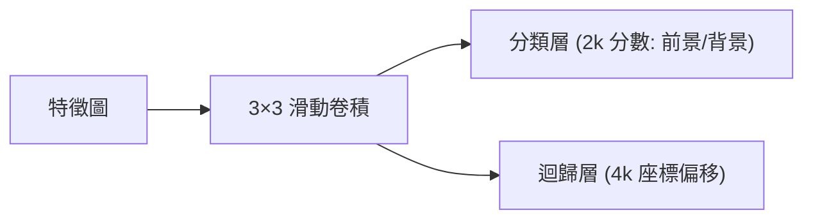

# Two-stage 偵測器演進史
## 從 2,000 個手工候選框到 RPN 神經網絡端到端學習

**授課主題**：R-CNN、Fast R-CNN、Faster R-CNN 到 Mask R-CNN  
**核心概念**：Selective Search、RoI Pooling、RPN、Anchor Boxes、RoIAlign  
**知識庫**：Object Detection LLMwiki  

---

# 1. 生活化理解：辦公室影印店的演進

想像你要從一張大合照中找出所有人的臉：

- **R-CNN（純手工搬運工）**：
  - 用剪刀剪下 2,000 張可能有人臉的碎紙片，把這 2,000 張碎紙片一張張送進影印機掃描 2,000 次！
  - *代價：一張照片推論耗時 47 秒，慢到懷疑人生。*
- **Fast R-CNN（共享掃描電子檔）**：
  - 聰明員工：「為什麼不先把整張照片掃描成一份高畫質電子檔？」大家直接在電子檔上圈框（RoI Pooling）。
  - *進展：神經網路只需 0.32 秒，但找那 2,000 個候選框在 CPU 仍需 2 秒！*
- **Faster R-CNN（全自動神經網路秘書）**：
  - 聘請 AI 秘書（RPN 網絡），找框與辨識一體成型，全流程只要 0.2 秒！

---

# 2. 第一代 R-CNN (2014)：深度學習的破曉

- **開創性貢獻**：首度將深度卷積網路（AlexNet）引入物件偵測。
- **運作流程**：
  $$\text{輸入影像} \to \text{Selective Search (2,000 候選框)} \to \text{強行扭曲 (Warping)} \to \text{CNN 抽取特徵} \to \text{SVM 分類 + 線性迴歸}$$

### 致命的三大痛點
1. **極度重複計算**：2,000 個重疊框各自跑一次 CNN，推論一張要 **47 秒**。
2. **多階段無法聯合訓練**：CNN 微調、SVM 訓練、座標回歸完全脫節。
3. **影像變形失真**：強行把任意長寬比扭曲為 $227 \times 227$，破壞物體幾何形狀。

---

# 3. 第二代 Fast R-CNN (2015)：共享特徵的革命

- **核心突破 1：共享特徵圖 (Shared Conv Feature Map)**
  - 整張大圖只進 CNN 一次，所有候選框直接映射到特徵圖上。
- **核心突破 2：RoI Pooling (候選區域池化)**
  - 將任意大小的候選特徵區域劃分為 $7 \times 7$ 網格做 Max Pooling，輸出固定維度，徹底免除影像 Warping 失真！
- **核心突破 3：多任務聯合損失 (Multi-task Loss)**
  - Softmax 分類與 Smooth L1 座標迴歸端到端聯合訓練。

> **殘存的速度瓶頸**：
> 雖然 GPU 神經網絡推論只要 0.32 秒，但前端 **Selective Search 仍需在 CPU 上消耗 2.0~2.3 秒**，候選框生成成為整個系統的最大絆腳石！

---

# 4. 第三代 Faster R-CNN (2015)：RPN 讓神經網路自己提框

- **革命性創舉：引入 RPN (Region Proposal Network)**
  - 徹底拋棄傳統 CPU 演算法，直接在 GPU 卷積特徵圖上用神經網絡預測候選框！
- **Anchor Boxes（錨框機制）**：
  - 在每個特徵點預設 $k=9$ 個多尺度、多長寬比的參考模板框。
  - 神經網路不需要無中生有猜座標，只需學習微調相對位移量 $(\Delta x, \Delta y, \Delta w, \Delta h)$。

---

# 5. 第四代 Mask R-CNN (2017)：邁向像素級分割

### 痛點：RoI Pooling 的「量化取整誤差」
- RoI Pooling 進行了兩次向下取整（如 $154 \div 16 = 9.625 \to 9$），小數點被粗暴捨棄。
- 在特徵圖上偏差 0.6 像素，放大回原圖就是十幾個像素的錯位！

### 突破：RoIAlign 雙線性插值
- 完全保留浮點數連續座標，網格內均勻採樣 4 個點進行**雙線性插值 (Bilinear Interpolation)**。
- 零量化誤差，直接讓 COCO 檢測 AP 提升 +1.1 點，並完美支援像素級**實例分割 (Mask Branch)**！

---

# 6. 客觀實驗數據對照表 (PASCAL VOC 2007)

*測試環境依原文標註：Nvidia K40 GPU，PASCAL VOC 2007 測試集*

| 模型名稱 | 候選區域產生方式 | 訓練耗時 | 測試耗時 (秒/張) | 速度提升倍數 | VOC 2007 mAP |
| :--- | :--- | :--- | :--- | :--- | :--- |
| **R-CNN** | Selective Search (CPU) | 84 小時 | 47.0 秒 | 1x（基準） | 66.0% |
| **Fast R-CNN** | Selective Search (CPU) | 9.5 小時 | 2.3 秒 *(純網路 0.32s)* | 20x | 70.0% |
| **Faster R-CNN** | **RPN (GPU 神經網路)** | **4.0 小時** | **0.2 秒 (約 5 FPS)** | **235x** | **73.2%** |

*數據來源：Girshick et al., 2014; Girshick, 2015; Ren et al., 2015; Lilian Weng, 2017*

---

# 7. 爭議與演進伏筆：5 FPS 算不算即時？

### 客觀事實矛盾與取捨
- Faster R-CNN 達到了 0.2 秒（5 FPS），在靜態相片或醫學判讀上堪稱極速。
- **但是在自動駕駛與無人機領域**：視訊流普遍需要 $\ge 30$ FPS。5 FPS 會造成嚴重的畫面延遲與盲區！
- Two-stage 的「先找候選框、再獨立分類」兩步走結構，先天注定了很難跨過 30 FPS 的實時大關。

### 下一講預告
👉 **第 3 講：One-stage 核心突破 —— YOLOv1 原始論文**  
*看 Joseph Redmon 如何顛覆兩階段思維，用「只看一眼的單一回歸」轟出 45 FPS 的極速傳奇！*
