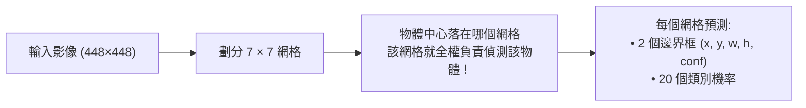

# One-stage 核心突破：YOLOv1
## 單一迴歸如何轟出 45 FPS 的即時檢測傳奇？

**授課主題**：You Only Look Once: Unified, Real-Time Object Detection  
**核心概念**：單一迴歸問題、$S \times S$ 網格機制、$7 \times 7 \times 30$ 張量、多部分加權損失  
**知識庫**：Object Detection LLMwiki  

---

# 1. 生活化理解：高塔瞭望守衛的啟示

- **Two-stage（如 Faster R-CNN，手持放大鏡的調查員）**：
  - 走遍整個房間，拿放大鏡圈出 300 個痕跡，再逐一翻查圖鑑核對。
  - *代價：0.2 秒一張（5 FPS），自動駕駛汽車開過一條街它才看清 5 幀畫面，反應太慢！*
- **YOLOv1（登高遠眺的瞭望守衛）**：
  - 站在高塔上一眼望去（You Only Look Once），直接把地圖劃分成 $7 \times 7 = 49$ 塊農田。
  - 同時大喊：「第 3 塊田有一頭牛、第 24 塊田有一輛馬車！」
  - *威力：1 秒鐘能掃描 **45 次（45 FPS）**，極速捕捉動態世界！*

---

# 2. 為什麼需要 YOLO？演進動機與實務痛點

### Faster R-CNN 的殘存遺憾
1. **即時性（Real-Time）斷層**：
   - 儘管 Faster R-CNN 達到了 0.2 秒（5 FPS），但自動駕駛、無人機避障、機器人操作普遍要求 $\ge 30$ FPS。
2. **缺乏全圖全域視野（Global Context）**：
   - Two-stage 的候選框裁剪讓模型「管中窺豹」，容易把背景雜訊誤認成物體。

> **革命性轉移**：
> 拋棄候選區域提議，將物件偵測重塑為**「單一迴歸問題（Single Regression Problem）」**！

---

# 3. 核心機制：S × S 網格責任分配

- **輸入**：整張原始影像一次性送入卷積神經網絡。
- **網格切分**：將影像切分為 $S \times S = 7 \times 7 = 49$ 個網格。
- **輸出維度**：$7 \times 7 \times (2 \times 5 + 20) = \mathbf{7 \times 7 \times 30}$ 維張量（共 1470 個預測值）。

---

# 4. 損失函數的加權天平設計

YOLOv1 全程採用均方和誤差（SSE），但利用權重巧妙調節不同目標的矛盾：

$$\begin{aligned}
\mathcal{L} &= \mathbf{5.0} \sum \text{中心座標誤差} + \mathbf{5.0} \sum (\sqrt{w} - \sqrt{\hat{w}})^2 \\
&\quad + 1.0 \sum \text{有物體信心度誤差} + \mathbf{0.5} \sum \text{背景無物體信心度誤差} \\
&\quad + 1.0 \sum \text{類別機率誤差}
\end{aligned}$$

- **$\lambda_{\text{coord}} = 5.0$**：大幅放大座標定位權重，確保框框不畫歪。
- **$\lambda_{\text{noobj}} = 0.5$**：49 個網格中大部分都是背景，大幅調低背景懲罰，防止背景梯度淹沒前景。
- **$\sqrt{w}, \sqrt{h}$ 開根號**：使小物體的微小尺寸偏差受到更嚴厲的懲罰！

---

# 5. 客觀實驗數據對照表 (Titan X GPU, VOC 2007)

*資料來源：Redmon et al., CVPR 2016 原文 Table 1*

| 檢測器模型 | 流派 | 卷積骨幹架構 | 推論幀率 (FPS) | VOC 2007 mAP | 是否符合即時標準 ($\ge 30$ FPS) |
| :--- | :--- | :--- | :--- | :--- | :--- |
| **Fast R-CNN** | Two-stage | VGG-16 | 0.5 FPS | 70.0% | 否 |
| **Faster R-CNN** | Two-stage | VGG-16 | 7.0 FPS | **73.2%** | 否 |
| **Faster R-CNN** | Two-stage | ZF | 18.0 FPS | 62.1% | 否 |
| **YOLO (標準版)** | One-stage | 24 層卷積 | **45.0 FPS** | 63.4% | **是 (即時 Real-time)** |
| **Fast YOLO** | One-stage | 9 層卷積 | **155.0 FPS** | 52.7% | **是 (極速 Extreme)** |

---

# 6. 客觀錯誤診斷：YOLO 與 Fast R-CNN 的優劣互補

*資料來源：Redmon et al., CVPR 2016 原文 Section 4.2（Hoiem et al. 診斷分析）*

### 雙方論文數據之客觀對照
- **背景誤檢錯誤（Background Error）**：
  - Fast R-CNN：**13.6%**（經常把背景雜訊當成目標）
  - YOLOv1：**4.75%**（全圖視野讓 YOLO 極少把純背景指鹿為馬！）
- **定位誤差（Localization Error）**：
  - Fast R-CNN：**8.6%**（RoI 精細精修，框畫得很準）
  - YOLOv1：**19.0%**（網格直接回歸較粗糙，框容易畫偏）

> **歷史亮點**：原文將 Fast R-CNN 與 YOLO 進行模型集成，mAP 暴增至 **75.0%**，證明兩者具有絕佳互補性！

---

# 7. 本講總結與下一講預告

### Key Takeaways
- **本質突破**：首創單階段密集網格回歸，達成 45 FPS 即時偵測。
- **全域視野**：背景誤檢率遠低於 Fast R-CNN（4.75% vs 13.6%）。
- **初代局限**：每個網格只能預測一個類別，成群小物體定位容易漏檢。

### 下一講預告
👉 **第 4 講：核心評估指標 —— 怎麼客觀評價「框得準不準」？**  
*拆解 IoU 門檻、Precision-Recall 曲線與 mAP@50 vs mAP@50:95 的數學奧秘！*
