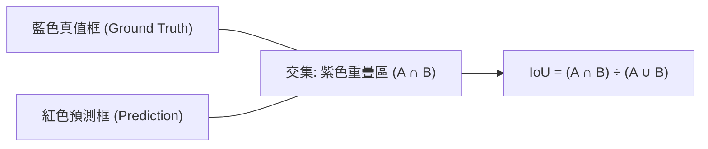

# 怎麼客觀評價「框得準不準」？
## IoU 交併比與 mAP 核心評估指標完全解密

**授課主題**：What is Mean Average Precision (mAP) in Object Detection?  
**核心概念**：IoU 交併比、TP/FP/FN 判定、P-R 曲線、mAP@50 與 mAP@50:95  
**知識庫**：Object Detection LLMwiki  

---

# 1. 為什麼不能只用傳統 Accuracy？

- **傳統分類**：只要回答「這張照片有沒有狗？」$\to$ 答對加 1 分、答錯扣 1 分。
- **物件偵測面臨的複雜挑戰**：
  1. **雙重任務**：不僅要認出「那是狗（分類）」，還要畫出方框（幾何定位）。
  2. **多物體與尺度多樣**：畫面中有 1 隻大狗、3 隻小貓，外加 90% 的純背景。
  3. **重複畫框**：如果模型在同一隻狗身上密集畫了 5 個方框，算對還是算錯？

> **評估需求**：必須有一套能同時量化「**找得全不全（Recall）**」、「**找得準不準（Precision）**」與「**框得貼不貼（IoU）**」的嚴密體系！

---

# 2. 交併比 (IoU)：兩張貼紙的重疊率

$$\text{IoU} = \frac{\text{交集面積 (Intersection)}}{\text{聯集面積 (Union)}} = \frac{\text{共同重疊部分}}{\text{總覆蓋面積}}$$

- **$\text{IoU} = 1.0$**：完全重疊（完美預測）。
- **$\text{IoU} = 0.5$**：重疊一半（PASCAL VOC 經典及格線）。
- **$\text{IoU} = 0.0$**：完全擦身而過（徹底脫靶）。

---

# 3. 判定答對還是答錯：殘酷的重複懲罰規則

設定一個 IoU 門檻 $\alpha$（例如 0.50）：

- **True Positive (TP, 真陽性)**：
  - 類別正確，且 $\text{IoU} \ge 0.50$。
- **False Positive (FP, 偽陽性 / 虛警)**：
  - 框在背景上、類別看錯，或 $\text{IoU} < 0.50$。
- **False Negative (FN, 偽陰性 / 漏檢)**：
  - 真實物體完全被模型忽略，沒有任何框命中。

> **初學者必知關鍵規則**：
> 如果同一個目標周圍出現了 3 個重疊的預測框，**只有置信度最高的第 1 個算 TP，其餘 2 個一律嚴格計為 FP**！  
> *（防止模型靠瘋狂大量畫框來作弊）*

---

# 4. Precision vs. Recall：永遠拉扯的消長天平

- **精確率 (Precision)**：$\frac{\text{TP}}{\text{TP} + \text{FP}}$  
  - 「在所有預測有東西的框裡，真正正確的佔比多少？」$\to$ **避免誤報（False Alarms）**。
- **召回率 (Recall)**：$\frac{\text{TP}}{\text{TP} + \text{FN}}$  
  - 「在畫面中所有真實存在的目標中，成功找到了多少？」$\to$ **避免漏檢（Missed Targets）**。

### 置信度門檻 (Confidence Threshold) 的調度
- **調高門檻 (保守)**：只在極有把握時出手 $\to$ Precision 飆高，但 Recall 暴跌（錯失大量目標）。
- **調低門檻 (激進)**：寧可錯抓不可放過 $\to$ Recall 飆高，但滿地虛警，Precision 暴跌。

---

# 5. P-R 曲線與 AP (Average Precision)

- **P-R 曲線**：將置信度門檻從 $1.0$ 一路調降到 $0.0$，動態繪製出 Precision（縱軸）與 Recall（橫軸）的對應軌跡。
- **AP（平均精度）**：計算 **P-R 曲線下的總面積（Area Under Curve, AUC）**。
  - 面積越接近 1.0，代表模型無論在保守還是激進狀態下都能保持高精度！
- **mAP (Mean Average Precision)**：
  $$\text{mAP} = \frac{1}{N} \sum_{i=1}^{N} \text{AP}_i \quad (\text{對所有 } N \text{ 個類別取算術平均})$$

---

# 6. 核心對決：mAP@50 vs. mAP@50:95 (COCO 標準)

| 評估標準 | 採用的 IoU 門檻 | 嚴格程度 | 考核目標 | 典型代表 |
| :--- | :--- | :--- | :--- | :--- |
| **mAP@50** (或 $\text{AP}_{50}$) | 單一門檻 $\text{IoU} = 0.50$ | 寬鬆（及格制） | 模型有沒有「大致框到」目標 | PASCAL VOC, 早期 YOLO |
| **mAP@50:95** (COCO Primary) | 10 個門檻平均： $0.50, 0.55, ..., 0.95$ | **極度嚴格**（名校制） | 同時考核「**有沒有找到**」與「**邊框貼合得有多緊密**」 | **現代 COCO 黃金標準** |

### 為什麼模型在兩者間落差極大？
- 一個框框畫得鬆散、略微偏斜的模型：
  - 在 $\text{IoU} = 0.50$ 容易拿高分（**mAP@50 可達 70%**）；
  - 但在 $\text{IoU} = 0.75 \sim 0.95$ 會全軍覆沒，**mAP@50:95 驟降至 38%**！

---

# 7. 本講總結與下一講預告

### Key Takeaways
- **IoU**：兩張貼紙的重疊率（交集 $\div$ 聯集），是 TP/FP 的分水嶺。
- **重複懲罰**：一個目標只認一個最高分框，其餘重複框全部算作虛警（FP）。
- **mAP@50:95**：現代標準，逼使模型不僅要分類準，邊界框更要貼合到亞像素極限。

### 下一講預告
👉 **第 5 講：進階應用 —— 為什麼斜著的物體水平框不住？**  
*走進 Ultralytics 旋轉框（OBB）的世界：衛星遙感、密集斜向排列與角度週期邊界難題！*
