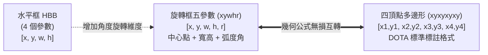
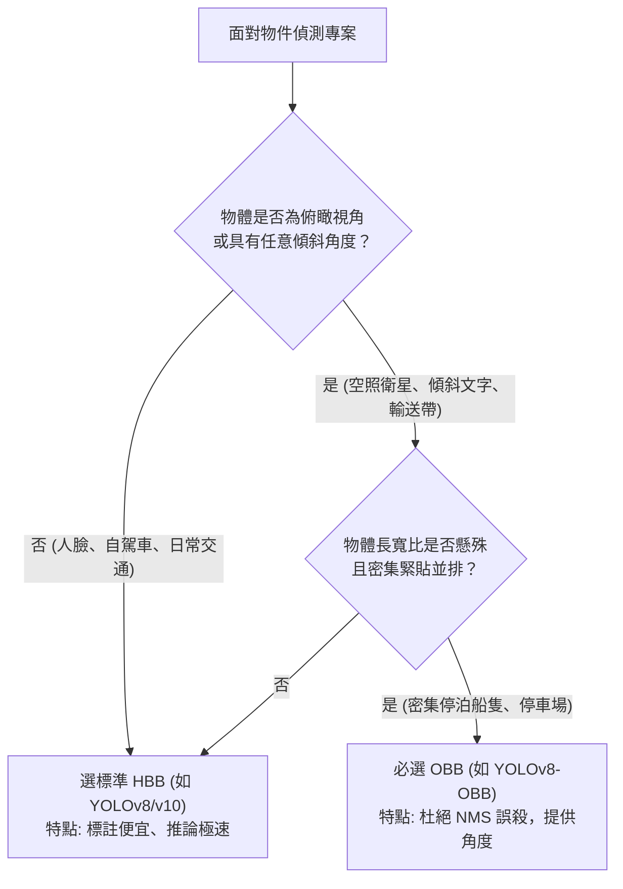
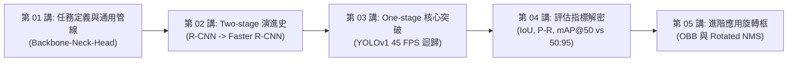

# 為什麼斜著的物體框不住？
## 旋轉邊界框 (Oriented Bounding Box, OBB) 原理與實戰

**授課主題**：Oriented Bounding Box Detection | Ultralytics YOLO Docs  
**核心概念**：HBB 局限性、OBB 格式（xywhr / xyxyxyxy）、角度週期邊界、Rotated NMS  
**知識庫**：Object Detection LLMwiki  

---

# 1. 生活化理解：紙箱裝吉他的啟示

想像你要打包運送一把斜著 45 度擺放的木吉他：

- **傳統水平框（HBB，常規四方大紙箱）**：
  - 快遞員只能拿一個長寬巨大的正方形箱子把整把吉他裝進去。
  - *代價 1：箱子裡 70% 都是空隙（塞滿了海浪、跑道等無關背景雜訊）。*
  - *代價 2：如果旁邊緊挨著並排擺了另一把吉他，兩個大箱子會瘋狂重疊碰撞！*
- **旋轉框（OBB，量身定做旋轉套）**：
  - 快遞員順著吉他的斜角轉動箱子，嚴絲合縫貼合琴身。
  - *威力：零背景雜訊；旁邊即使排了 20 把吉他，箱子之間也互不干擾！*

---

# 2. 傳統水平框 (HBB) 面對遙感空照的兩大絕症

1. **背景雜訊干擾嚴重 (Background Clutter)**：
   - 航拍照片中的船隻、飛機、跑道等細長物體通常呈斜向分佈。
   - 水平框內大部分像素都是海水或停機坪，模型提取到的純物體特徵被嚴重稀釋。

2. **密集排列下 NMS 的「互殺慘劇」 (NMS False Suppression)**：
   - 多艘細長船隻平行並靠在碼頭時，相鄰兩艘船的水平外接矩形**重疊度通常高達 70%~80%**。
   - 標準 NMS 會把旁邊那艘真實的船直接當成重複框誤刪，造成驚人的漏檢率！

---

# 3. OBB 的座標表示法

- **`xywhr`**：模型預測頭輸出的五維向量，通常以長邊為基準（Long-edge convention），角度以弧度表示。
- **`xyxyxyxy`**：記錄 4 個頂點的順序座標，精確適應任意傾斜四邊形。

---

# 4. 數學挑戰：角度週期性與邊界跳躍

### 矩形的 $180^\circ$ 旋轉對稱性
- 矩形框旋轉 $180^\circ$（$\pi$ 弧度）後，幾何形狀與旋轉前**完全一致**。
- 若定義域為 $[-\pi/2, \pi/2)$，當物體在 $-89.9^\circ$ 與 $+89.9^\circ$ 之間微小震顫時：
  - 視覺上物體幾乎沒動，但數值差距高達 $179.8^\circ$！
  - 神經網絡若直接計算數值誤差，會引發毀滅性的梯度爆炸！

### Ultralytics 解決方案
- 採用長邊定義，約束角度在 **$[-\pi/4, 3\pi/4)$**，配合週期性平滑損失函數消除邊界跳躍。

---

# 5. Rotated NMS：多邊形裁剪拯救密集目標

- **傳統 NMS 的死穴**：只會用簡單的坐標上下限算水平面積，導致並排船隻被判定為超高 IoU 而被殺。
- **Rotated NMS 的突破**：
  - 引入 **Sutherland-Hodgman 多邊形求交演算法**，真實計算兩個旋轉矩形重疊的幾何凸多邊形面積。
  - 並排斜靠的兩艘船，其 **Rotated IoU 幾乎為 0**！
  - 兩艘船全部被完美保留，密集目標召回率大幅飆升！

---

# 6. 客觀 Benchmark 實測 (DOTA v1.0 遙感資料集)

*資料來源：Ultralytics YOLO Docs, 2024*

| 模型名稱 | 輸入解析度 | DOTA v1.0 $\text{mAP}_{50}$ | 參數量 (Params) | 計算量 (FLOPs) | 適用場景 |
| :--- | :--- | :--- | :--- | :--- | :--- |
| **`yolov8n-obb`** | 1024 | **78.0%** | 3.1 M | 23.3 B | 邊緣端無人機、即時航拍巡檢 |
| **`yolov8s-obb`** | 1024 | **79.5%** | 11.4 M | 76.3 B | 伺服器平衡型推論 |
| **`yolov8m-obb`** | 1024 | **80.5%** | 26.4 M | 168.6 B | 高精度衛星遙感解譯 |

---

# 7. 工程選型決策路徑 (HBB vs. OBB)

---

# 8. 全系列 5 講知識庫大圓滿

> **恭喜！你已完整建立起現代物件偵測的演進骨幹與認知地基！**
