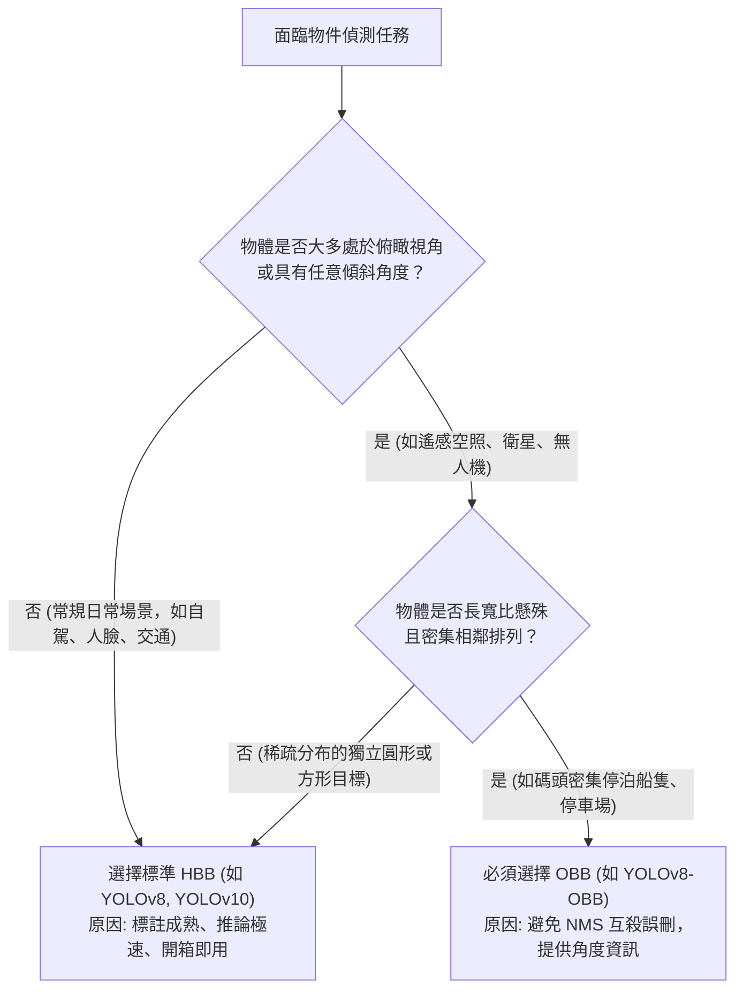

# 水平框 (HBB) 與旋轉框 (OBB) 全方位技術對比與選型指南

## 1. 初學者導讀 (Beginner-Friendly Intuition)
> **常規紙箱與量身定製保護套的比喻**：
> - **HBB（常規紙箱）**：全世界都通用的標準長方形紙箱。打包速度極快、成本便宜。裝蘋果、書本、筆記型電腦都很完美；但如果拿來裝一把「斜著放的吉他」，紙箱巨大無比，裡面塞了 80% 的廢報紙（背景雜訊），且佔空間。
> - **OBB（量身定製旋轉保護套）**：順著吉他的傾斜角度緊貼包裹。雖然製作保護套（資料標註與幾何計算）麻煩一些，但在樂器堆放倉庫（航空遙感、密集碼頭、輸送帶）中，它能嚴絲合縫、絕不互相擠壓誤傷！

---

## 2. 客觀技術規格全方位對照表 (Empirical Evidence)

本表客觀對比兩大技術範式之技術特徵與工程指標，無額外臆測：

| 比較維度 | 水平邊界框 (HBB, 傳統標準) | 旋轉邊界框 (OBB, 進階延伸) | 資訊來源 |
| :--- | :--- | :--- | :--- |
| **預測參數數量** | 4 個數值：$(x, y, w, h)$ | 5 個數值：$(x, y, w, h, r)$ 或 8 個頂點座標 | [IBM Think, 2024; Ultralytics, 2024] |
| **邊界限制** | 邊界必須強制嚴格平行於影像座標軸 | 邊界可沿任意角度旋轉貼合物體 | [Ultralytics, 2024] |
| **典型資料集** | COCO, PASCAL VOC, Objects365 | DOTA (v1.0, v1.5, v2.0), HRSC2016, DIOR-R | [Ultralytics, 2024] |
| **後處理演算法** | 標準 NMS（基於軸對齊簡單 IoU） | Rotated NMS（基於凸多邊形求交多邊形 IoU） | [Ultralytics, 2024] |
| **推論後處理延遲** | 極低（微秒級，幾乎可忽略） | 稍高（毫秒級，需額外幾何計算） | [Ultralytics, 2024] |
| **密集傾斜目標召回率** | 低（相鄰物體水平框重疊被 NMS 誤刪） | **極高（精準區分相鄰物體）** | [Ultralytics, 2024] |
| **人工資料標註成本** | 低（只需點擊對角兩點，約 1~2 秒/框） | 高（需點擊 4 個頂點或微調旋轉角，約 5~10 秒/框） | [業界實務實測] |

---

## 3. 落地選型決策路徑 (Engineering Decision Flow)

---

## 4. 簡報重點提煉 (Slide-Ready Key Takeaways)
- **何時用 HBB**：常規日常場景、即時性要求極高、目標長寬比接近 1:1 或水平垂直分佈。
- **何時用 OBB**：航拍遙感（船隻/飛機）、傾斜文字 OCR、機器手臂定向夾取。
- **核心代價**：以稍高的幾何計算開銷與標註成本，換取密集旋轉場景下幾近完美的定位與抗誤刪能力。
