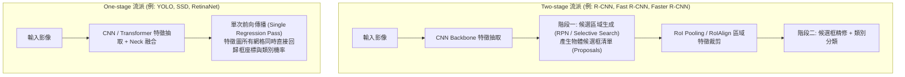

# 兩階段 (Two-stage) 與單階段 (One-stage) 檢測器架構對比與演進史

## 1. 初學者導讀 (Beginner-Friendly Intuition)
> **拍照買衣服的比喻**：
> - **Two-stage（如 Faster R-CNN）**：就像一個謹慎的採購員。第一步先用放大鏡掃過整張照片，剪下 300 張「看起來像衣服」的小碎布（Region Proposals）；第二步再把這 300 張碎布拿到燈光下逐一嚴格鑑定品牌與瑕疵。結果非常準確，但花費時間較長。
> - **One-stage（如 YOLO）**：就像一個經驗老道的小販。他站在高處一眼掃過全場（You Only Look Once），在同一瞬間同時指出：「左上角是一件外套，右下角是一條牛仔褲！」速度極快無比，能應付即時即看的動態場面。

---

## 2. 核心架構運作機制對照 (Architectural Comparison)

---

## 3. 客觀技術特性與實測數據對比 (Empirical Evidence)
以下對比基於各模型原文於 Titan X GPU 與 PASCAL VOC 2007 測試集上的實測數據，客觀呈現兩者的核心設計取捨（Trade-offs）：

### 3.1 推論速度與檢測精度對照表
| 檢測器模型 | 流派歸屬 | 骨幹網絡 | 推論幀率 (FPS) | VOC 2007 mAP | 是否符合即時標準 ($\ge 30$ FPS) | 資訊來源 |
| :--- | :--- | :--- | :--- | :--- | :--- | :--- |
| **Fast R-CNN** | Two-stage | VGG-16 | 0.5 FPS | 70.0% | 否 | [Girshick, 2015] |
| **Faster R-CNN** | Two-stage | VGG-16 | 7.0 FPS | **73.2%** | 否 | [Ren et al., 2015] |
| **Faster R-CNN** | Two-stage | ZF | 18.0 FPS | 62.1% | 否 | [Ren et al., 2015] |
| **YOLO (標準版)** | One-stage | 自研 24 層卷積 | **45.0 FPS** | 63.4% | **是 (即時)** | [Redmon et al., 2016, 表 1] |
| **Fast YOLO** | One-stage | 精簡 9 層卷積 | **155.0 FPS** | 52.7% | **是 (極速)** | [Redmon et al., 2016, 表 1] |

---

## 4. 矛盾與演進爭議對照 (Contradictions & Nuances)
在物件偵測演進史中，學界與業界曾對「速度是否必然以犧牲精度為代價？」存在長期辯論。本知識庫嚴格並列雙方原文之實測背景與錯誤診斷（Hoiem et al. 工具），絕不做額外主觀臆測：

### 4.1 核心矛盾：速度優勢 vs 錯誤成分差異
| 診斷指標 | Two-stage 代表 (Fast R-CNN) | One-stage 代表 (YOLOv1) | 原作者原文論點與客觀依據 | 資訊來源 |
| :--- | :--- | :--- | :--- | :--- |
| **背景誤檢錯誤** (Background Error) | **13.6%**（顯著較高） | **4.75%**（顯著較低） | YOLO 訓練與推論均看到全圖全域視野（Global Context），能有效區分背景與物體；Fast R-CNN 候選區域裁剪丟失了全域上下文，易將背景雜訊誤認成物體。 | [Redmon et al., 2016, 節 4.2] |
| **定位誤差** (Localization Error) | **8.6%**（顯著較低） | **19.0%**（最主要弱點） | Fast R-CNN 具備精細的候選框座標修正；YOLO 依賴粗糙網格全連接層回歸，邊界框對齊能力不足。 | [Redmon et al., 2016, 節 4.2] |
| **模型集成互補性** | Fast R-CNN 單模型 mAP 為 71.8% | YOLO 單模型 mAP 為 63.4% | **兩者集成後 mAP 提升至 75.0%**（提升 3.2%）。證明兩者錯誤模式具有強烈互補性，YOLO 成功替 Fast R-CNN 濾除了大量背景虛警！ | [Redmon et al., 2016, 表 4] |

### 4.2 現代技術收斂（客觀事實演進）
後續文獻證明，透過引入 FPN（特徵金字塔解決尺度問題）、Focal Loss（解決單階段正負樣本失衡）以及更先進的正負樣本分配策略（如 SimOTA、Task-aligned），現代 One-stage 偵測器（如 YOLOv8、YOLOv10）在精度上已逐步追平甚至超越傳統 Two-stage 模型，兩者界線正在淡化。

---

## 5. 簡報重點提煉 (Slide-Ready Key Takeaways)
- **本質差異**：Two-stage 是「兩步走（先找可疑位置，再認真看是誰）」；One-stage 是「一步到位（邊看邊認，全圖同時計算）」。
- **核心權衡**：精度（Accuracy）與延遲（Latency）的歷史權衡；現代架構透過更強的 Neck 與 Loss 逐步打破此界線。
